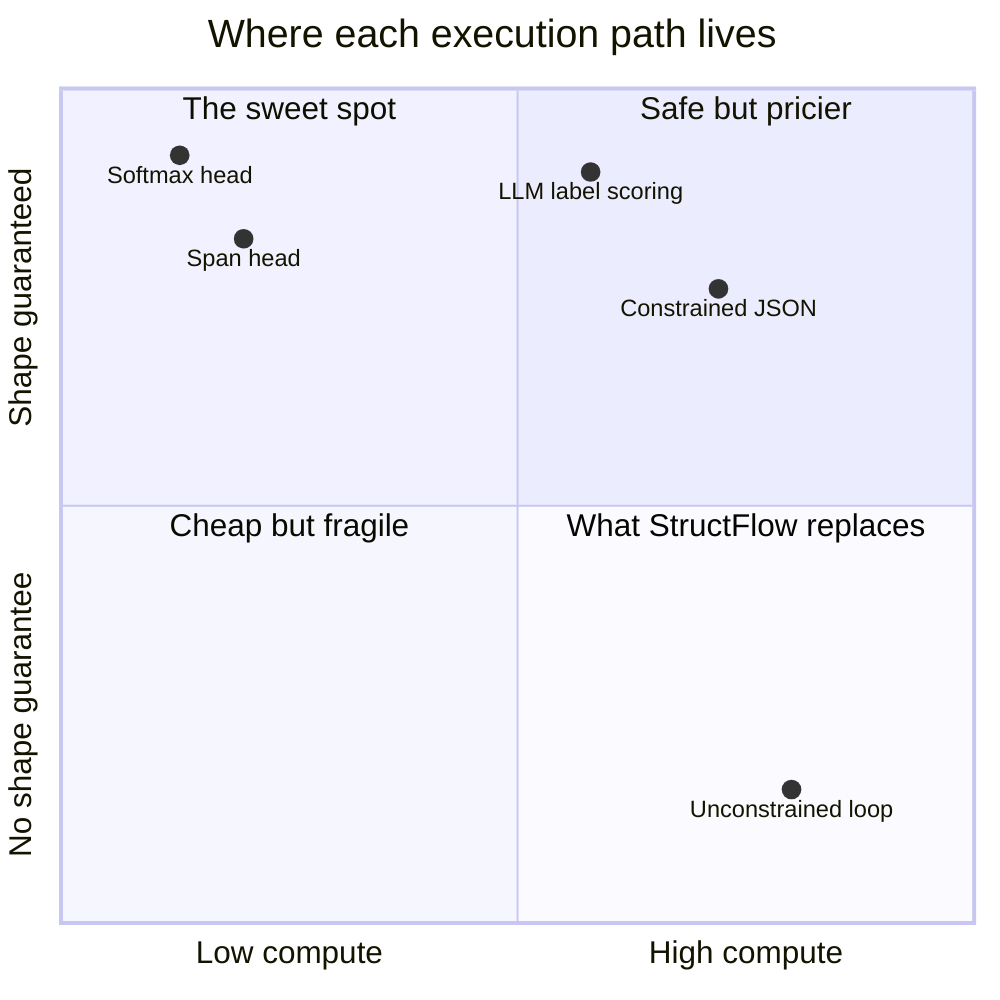
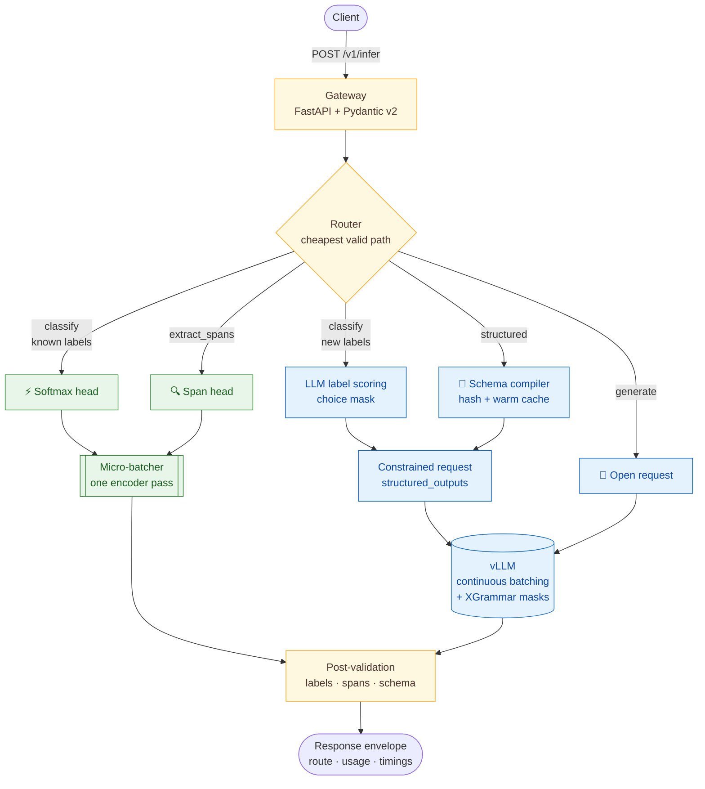
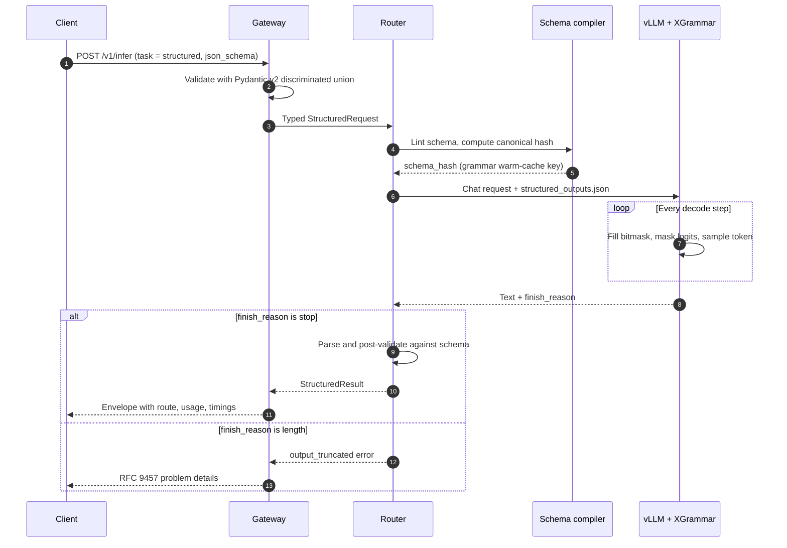
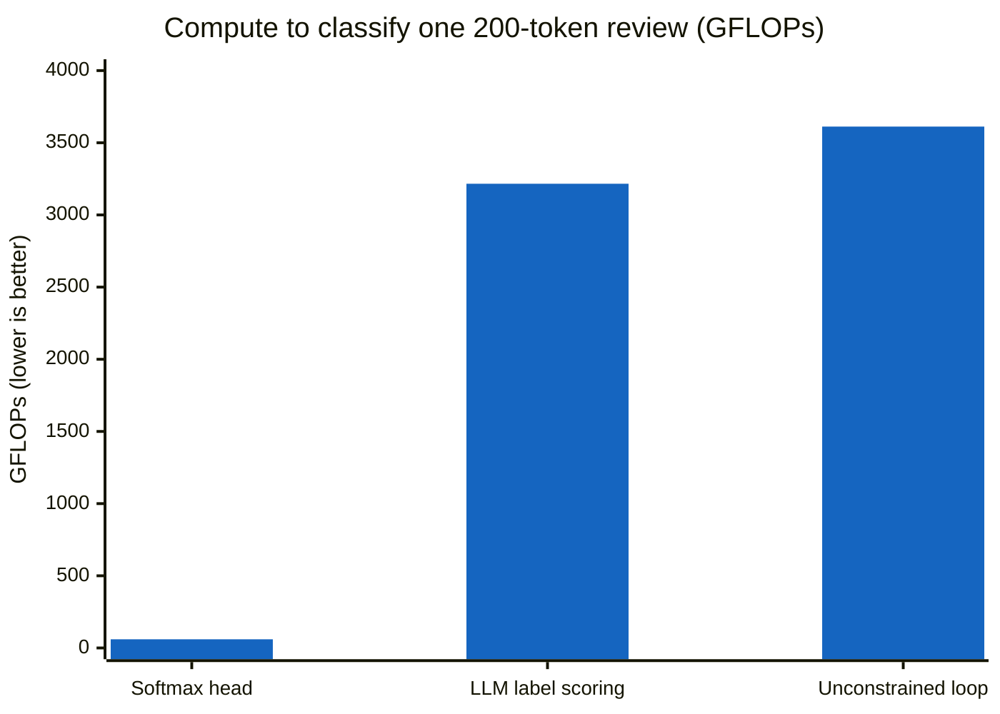
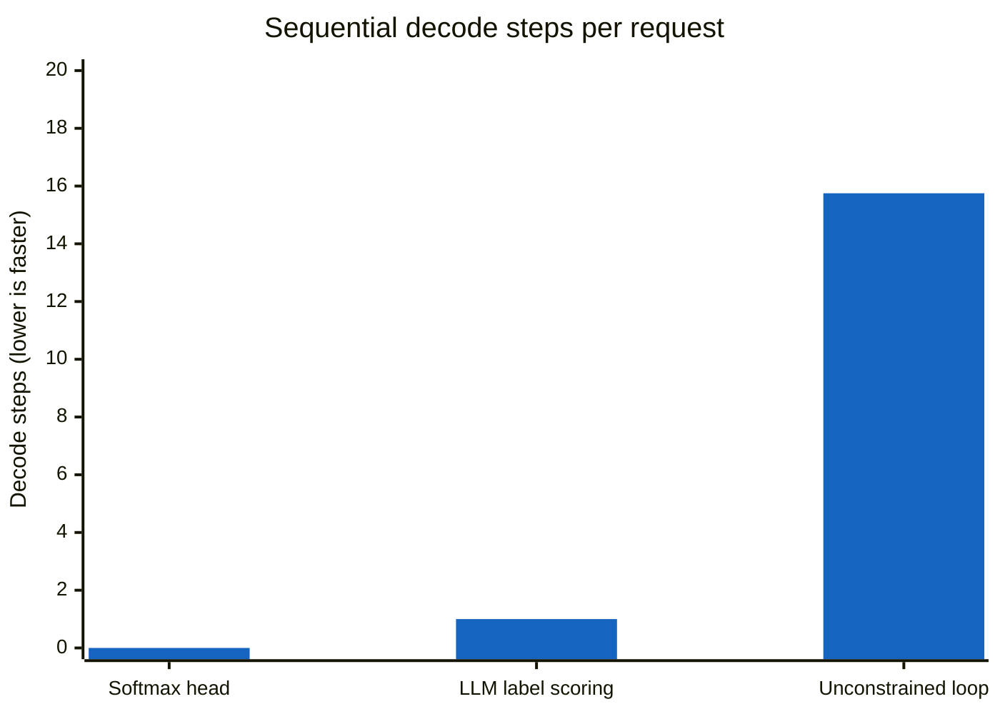
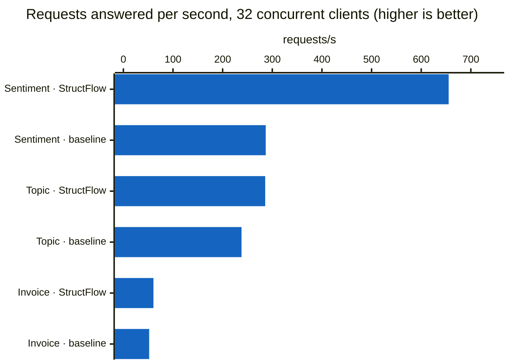
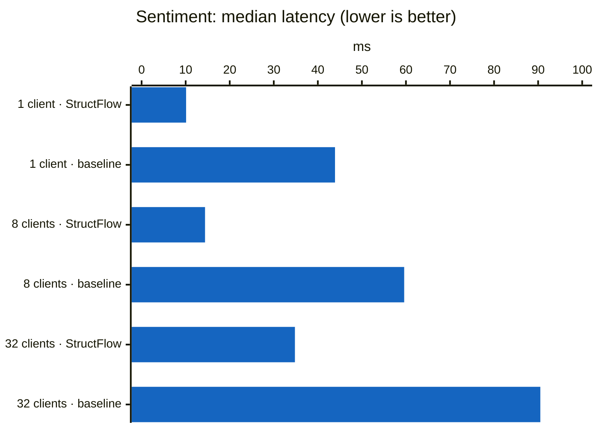
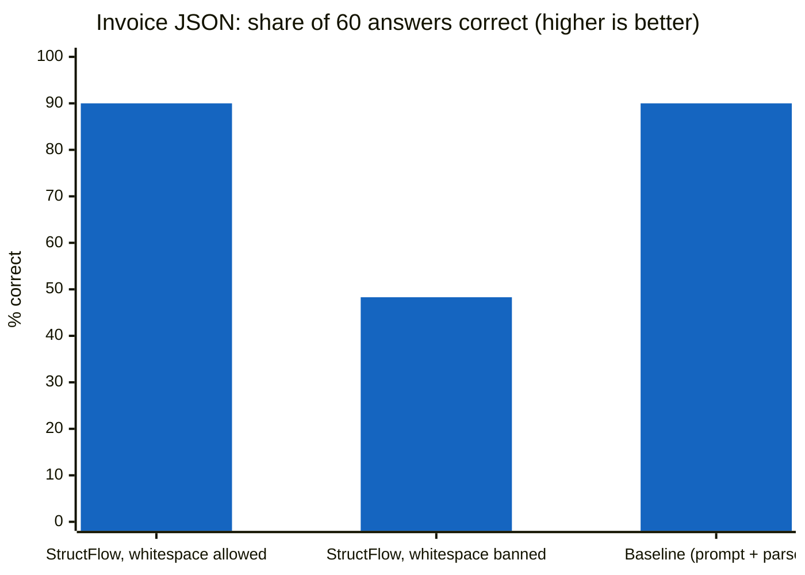
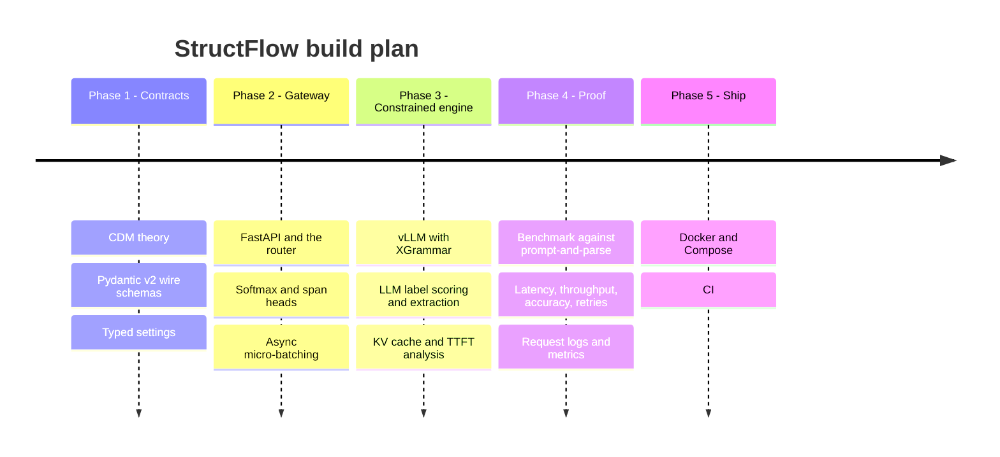

<div align="center">

# StructFlow

### Stop paying for essays when you asked for a checkbox.

**A high-throughput structured inference gateway. Every request goes down the cheapest path that still guarantees the shape of the answer.**


*The fastest token is the one you never generate.*

</div>

> [!IMPORTANT]
> StructFlow is being built in public, one phase at a time. **Phases 1–4 are done: the gateway, the small models, vLLM + XGrammar on a real GPU, and a benchmark against the usual prompt-and-parse approach. Phase 5 (Docker and CI) is next.** The diagrams below describe the target architecture; the [roadmap](#roadmap) shows exactly what is real so far, and **[What I measured](docs/findings.md)** has the numbers.

---

## The 10-second pitch

| You need… | A raw LLM gives you… | StructFlow gives you… |
|---|---|---|
| One label out of three | `Sure! Based on the review, I'd say the sentiment is positive.` | `positive`, from one forward pass of a small model |
| The people named in a support ticket | Three names, one of which it made up | Exact slices of your text, with character offsets |
| A JSON invoice record | `Here's the JSON: {"total": 42, "items": [` …and then it stops | JSON that always parses, enforced token by token |
| An open-ended answer | An open-ended answer | An open-ended answer (nothing to constrain) |

**What the benchmark found** ([full results](#benchmark-results)):

- **Routing is the big win.** Sending a label the small model knows to the small model: **4.4× lower latency** (10 vs 44 ms) and **2.3× the throughput** at 32 clients, with **zero LLM tokens**, for one wrong answer in 60.
- **The grammar mask costs nothing measurable**, even under load: same accuracy and tokens as prompting, slightly better tail latency.
- **Llama-3.1-8B never needed a retry** on these tasks, so the guarantee was insurance that never had to pay out. The next experiment looks for where it does.
- **The trap:** banning JSON whitespace saved tokens but **cut accuracy from 90% to 48%**. Valid JSON, wrong answers.

## Why this exists

Most LLM applications don't want prose. They want a **label**, a **list of entities**, or a **JSON object with exact fields**. The common pattern is to let a large model write freely, then dig the answer out of the text. That pattern has three costs:

- **It's slow.** Every generated token is a full pass through billions of parameters, and most of those tokens are filler.
- **It's expensive.** GPU time is spent writing sentences nobody reads.
- **It can break, and the retries hurt the tail.** If 95% of responses parse, 1 in 20 requests runs twice, and your **P99 latency lands inside that retried group**. How often it breaks depends on the model and the task: in [our benchmark](#benchmark-results), Llama-3.1-8B at temperature 0 never broke on simple tasks; smaller models, deeper schemas and higher temperatures are where we expect it to (the next experiment).

StructFlow removes the loop instead of making it faster.

## The vision

1. **Contracts, not prompts.** The caller declares the shape of the answer: a label set, entity types, a JSON Schema, a regex or a grammar. The gateway owns the guarantee.
2. **The cheapest path that satisfies the contract.** A label from a fixed set never needs a decode loop. A JSON object never needs a retry loop.
3. **Grounded by construction.** Extracted entities are slices of the input, `text[start:end]`, never paraphrases.
4. **Measured, not claimed.** Every response says which path served it, how many forward passes it took and how long each stage ran. Benchmarks, not adjectives, decide the charts.
5. **Honest about the edges.** Truncation, distribution distortion and whitespace loops are tracked as metrics, not hidden.

## Four lanes, one contract

| Lane | Serves | Engine | Sequential decode steps | Shape guarantee |
|---|---|---|---|---|
| ⚡ **Softmax head** | Classification over a known label set | Encoder + linear layer + softmax | 0 | The output is one of the K labels |
| 🔍 **Span head** | Entity and span extraction | Token classification + offset mapping | 0 | Every span is exactly `text[start:end]` |
| 🧭 **Constrained generation** | JSON Schema, regex, choice, grammar | vLLM + XGrammar token bitmask | N (short) | The output parses, if generation finishes |
| 💬 **Open generation** | Open-ended questions | vLLM, no mask | N | None needed |

The constrained lane also covers classification when no local head knows the labels: **LLM label scoring.** A `choice` constraint lets the 8B model write only one of the given labels, and the score comes from its token logprobs. One caveat, [measured on vLLM](docs/findings.md#3-vllms-logprobs-are-taken-after-the-grammar-mask): those logprobs are taken after the grammar mask, so the score ranks the given labels against each other; it is not the model's belief that the label is true.


<sub>Illustrative positioning, not measured data.</sub>

## Architecture


<sub>🟩 local encoder heads · 🟦 vLLM paths · 🟨 gateway logic</sub>

**How it stays fast under load**

- **The event loop never runs a model.** Encoder heads run behind an async micro-batcher on a dedicated executor. Requests are grouped for up to a few milliseconds, then served by one batched forward pass.
- **The gateway doesn't batch LLM requests.** vLLM's continuous batching already does that better. The gateway forwards requests concurrently over one shared HTTP client.
- **Backpressure is explicit.** The encoder queues are bounded and LLM requests in flight are capped. When full, the gateway answers `503` with `Retry-After` at once instead of letting a queue silently inflate latency ([why it matters](docs/findings.md#a-bounded-queue-protects-the-tail)).
- **Abandoned requests free memory.** A client disconnect (or the gateway's own deadline) cancels the upstream generation, so its KV-cache blocks go back to the pool. [Verified on a GPU](docs/findings.md#4-cancellation-reaches-the-gpu).
- **vLLM stays private.** It sits on an internal network that only the gateway can reach.
- **Every request is observable.** One JSON log line per request (route, trail, tokens, timings, error code) and Prometheus metrics at `/metrics`.

## Life of a structured request



## How the guarantee works

At every decode step, the grammar's current state decides which tokens are legal. Every other token's logit is set to −∞ before sampling:

```math
\tilde\ell_i=\begin{cases}\ell_i & i\in\mathcal{V}(s_t)\\ -\infty & \text{otherwise}\end{cases}
\qquad y_t\sim\mathrm{softmax}(\tilde\ell/\tau)
\qquad s_{t+1}=\delta(s_t,y_t)
```

- **Regex and choice** are regular languages. A finite-state machine handles them, and every state's mask can be precomputed.
- **Nested JSON** is context-free. It needs a stack (a pushdown automaton), so not every mask can be precomputed.
- **XGrammar's trick:** most tokens' validity depends only on the automaton's local position, so it precomputes and caches those per node. Only the few tokens that need the full stack are checked at runtime.

The mask itself is one bit per vocabulary entry:

| Model | Logit width (vocab) | int32 words per row | Bytes per row | 256 constrained rows per step |
|---|---:|---:|---:|---:|
| Llama-3.1-8B | 128,256 | 4,008 | ≈ 15.7 KiB | ≈ 4.1 MB |
| Qwen2.5-7B | 152,064 | 4,752 | ≈ 18.6 KiB | ≈ 4.9 MB |

Moving and applying the mask is cheap. The real costs are **CPU-side mask computation** for each constrained row and **grammar compilation on a cache miss**. That's why StructFlow hashes every schema canonically and keeps popular grammars warm.

<details>
<summary><b>The fine print: what the guarantee does not cover</b></summary>

1. **Truncation.** A response cut off by `max_tokens` is an invalid prefix. "Always parses" holds only for `finish_reason == "stop"`, so StructFlow returns an explicit `output_truncated` error and tracks truncation as its own metric.
2. **Distribution distortion.** Renormalizing at each step is not the same as conditioning on valid outputs. The mask enforces syntax; the prompt still has to carry the meaning, so the schema goes in the prompt too.
3. **Whitespace loops, and the cure that hurts.** JSON allows unlimited whitespace, and a model can emit newlines until it hits the cap. Banning optional whitespace (a vLLM startup flag) cut one answer from 96 to 54 tokens, but on 60 invoices it [cut accuracy from 90% to 48%](docs/findings.md#11-the-whitespace-trap): the model writes JSON with spaces, and forbidding them distorted its answers. StructFlow keeps vLLM's default and leans on `max_tokens` plus the `output_truncated` error instead.
4. **Syntax is not truth.** A schema-valid object can still be wrong, and some JSON Schema keywords may not be enforceable by a given backend. Every output is post-validated. A narrow schema can even *push* the model into a wrong answer when the prompt gives it no way to say "none": [a real example](docs/findings.md#2-a-constraint-guarantees-the-shape-not-the-truth).

</details>

## Back-of-the-envelope: why the lanes matter

The scenario: classify the sentiment of a 200-token product review.




<sub>"Unconstrained loop" = free generation, parse, and retry on failure (~5% of requests). The softmax head has no decode bar because it takes exactly zero decode steps.</sub>

> [!NOTE]
> These are **analytical estimates, not benchmarks.** Assumptions: FLOPs ≈ 2 × parameters × tokens (attention ignored); Llama-3.1-8B ≈ 8.0B parameters; encoder ≈ 150M parameters; an unconstrained answer of ≈ 15 tokens; 95% parse success, so ≈ 1.05 attempts per request. **The measured version is in [Benchmark results](#benchmark-results)**: the routing win held up (4.4× lower latency), while the 5% retry rate assumed here did not appear for Llama-3.1-8B on these tasks.

**The takeaway:**
- The softmax head does **roughly 50–60× less compute** than either LLM path.
- LLM label scoring still pays for the prompt (prefill), but it collapses ~16 sequential decode steps into 1. There, the win is **latency**, not FLOPs.
- Prefix caching of the shared system prompt can shrink the prefill further.

## Measured so far

Every measurement so far, from single requests to the full benchmark. Details, methods and caveats: **[docs/findings.md](docs/findings.md)**.

| Finding | Number |
|---|---|
| Micro-batching the softmax head (64 requests, Apple `mps`) | **2.4×** faster than one at a time |
| Bounded queue vs a big one at 400 req/s | p99 **80 ms** vs **782 ms** |
| Small head vs LLM fallback, one classification | **132 ms** vs **602 ms** |
| Fixing the entity prompt's escape hatch | wrong label gone, **67 → 31** tokens, **1.6 → 0.9 s** |
| Llama-3.1-8B decode speed, 1 request, RTX 4090 | **≈ 59 tokens/s** (memory-bandwidth bound) |
| KV cache per token, Llama-3.1-8B | **128 KiB**; 4.49 GiB holds 36,768 tokens |
| Client hang-up or gateway timeout | vLLM stops generating within one log window |
| Grammar mask cost per token (JSON Schema, XGrammar) | **+0.1 ms** on 15.7 ms (< 1%) |
| Compiling a never-seen grammar | **≈ 170 ms**, once, then cached |
| Banning JSON whitespace | **96 → 54 tokens (−44%)**, but accuracy **90% → 48%** |
| Small head vs prompted LLM, sentiment, 32 clients | **655 vs 287 requests/s** |
| Masked vs prompted JSON, accuracy and tokens | **90% vs 90%**, 35.4 vs 35.3 tokens |
| Baseline retries needed (Llama-3.1-8B, temperature 0) | **0%** on all three tasks |

## Benchmark results

StructFlow against the usual way (instructions in the prompt, a forgiving parser, up to 3 retries) on three labelled tasks of 60 examples each, at 1, 8 and 32 concurrent clients. Same GPU (an RTX PRO 6000), same model (Llama-3.1-8B-Instruct) and same gateway for both, so only the method differs. Every number below is generated from [`benchmarks/results/`](benchmarks/results/) by `python -m structflow.bench.charts`.







| Task | Correct (StructFlow / baseline) | Retries needed by the baseline | What it shows |
|---|---|---|---|
| Sentiment | 98% / 100% | 0% | The small head is 4.4× faster and serves 2.3× the load, with no LLM tokens |
| Topic | 100% / 100% | 0% | LLM label scoring matches prompting; slightly more throughput |
| Invoice → JSON | 90% / 90% | 0% | The mask costs nothing; both miss the same share of messy inputs |

**Read with care:** one run each, synthetic data, one model at temperature 0. The full table, method and caveats are in **[docs/findings.md](docs/findings.md#phase-4-structflow-against-the-usual-way-under-load)**.

## API preview

> [!TIP]
> The endpoint is live. Values below are illustrative; the published JSON Schemas are in [`docs/contracts/`](docs/contracts/).

**Classify with a local head**

```jsonc
// POST /v1/infer
{
  "task": "classify",
  "text": "Checkout was painless and the package arrived a day early.",
  "labels": ["positive", "negative", "neutral"]
}
```

```jsonc
// 200 OK
{
  "route": "softmax_head",
  "route_trail": ["softmax_head"],
  "degraded": false,
  "result": {
    "task": "classify",
    "labels": [
      { "label": "positive", "score": 0.97 },
      { "label": "neutral",  "score": 0.02 },
      { "label": "negative", "score": 0.01 }
    ]
  },
  "usage": { "prompt_tokens": 14, "completion_tokens": 0, "forward_passes": 1 },
  "timings": { /* queue_ms, inference_ms, total_ms; ttft_ms and tpot_ms when an LLM answered */ }
}
```

**Structured extraction with a JSON Schema**

```jsonc
// POST /v1/infer
{
  "task": "structured",
  "messages": [{ "role": "user", "content": "Extract the invoice: ACME Corp billed $1,240 on 2026-10-01." }],
  "constraint": {
    "type": "json_schema",
    "schema": {
      "type": "object",
      "properties": {
        "vendor": { "type": "string" },
        "amount_usd": { "type": "number" },
        "date": { "type": "string" }
      },
      "required": ["vendor", "amount_usd", "date"]
    }
  }
}
```

## Quickstart (what runs today)

**1. Install and test.** No GPU or model downloads needed: the default backends are fakes.

```bash
git clone https://github.com/adibatwal7/structflow.git
cd structflow
python -m venv .venv && source .venv/bin/activate
python -m pip install -e ".[dev]"
cp .env.example .env
pytest
```

**2. Run the gateway and send a request.**

```bash
uvicorn --factory structflow.gateway.app:create_app --port 8080
```

```bash
curl -s localhost:8080/readyz
curl -s localhost:8080/v1/infer -H "Content-Type: application/json" \
  -d '{"task":"classify","text":"The food was great","labels":["great","awful"]}'
```

**3. Use real small models** (downloads two DistilBERT models from Hugging Face; runs on CPU, CUDA or Apple `mps`):

```bash
python -m pip install -e ".[dev,ml]"
export STRUCTFLOW_CLASSIFIER_BACKEND=hf
export STRUCTFLOW_SPAN_BACKEND=hf
uvicorn --factory structflow.gateway.app:create_app --port 8080
```

**4. Connect a vLLM server** for the generation lanes. Start vLLM on a GPU machine, bound to localhost and protected by a key:

```bash
vllm serve meta-llama/Llama-3.1-8B-Instruct --host 127.0.0.1 --port 8000 \
  --api-key "$VLLM_KEY" --max-model-len 8192 \
  --structured-outputs-config.backend xgrammar
```

Leave JSON whitespace allowed (vLLM's default): banning it [cut invoice accuracy from 90% to 48%](docs/findings.md#11-the-whitespace-trap).

If vLLM runs on another machine, reach it through an SSH tunnel rather than exposing it (`ssh -N -L 8000:127.0.0.1:8000 user@gpu-host`). Then point StructFlow at it:

```bash
export STRUCTFLOW_GENERATOR_BACKEND=vllm
export STRUCTFLOW_VLLM_BASE_URL=http://localhost:8000/v1
export STRUCTFLOW_VLLM_API_KEY="$VLLM_KEY"
uvicorn --factory structflow.gateway.app:create_app --port 8080
```

**5. Load-test it** with the built-in open-loop load generator:

```bash
python -m structflow.bench.load --task classify --rps 200 --duration 10
```

**6. Benchmark it against prompt-and-parse**, then turn the results into tables and charts:

```bash
python -m structflow.bench.compare --concurrency 1,8,32 --json results.json
python -m structflow.bench.charts results.json
```

**7. Watch it.** Every inference request prints one JSON log line, and Prometheus metrics (requests by route and outcome, latency, TTFT, tokens, fallbacks) are at `http://localhost:8080/metrics`.

**Configuration.** Settings are read from `STRUCTFLOW_*` environment variables or `.env`, and validated at startup. A bad value refuses to boot instead of misbehaving later. [`.env.example`](.env.example) lists them all.

| Variable | Default | Meaning |
|---|---|---|
| `STRUCTFLOW_CLASSIFIER_BACKEND` | `fake` | Softmax head: `fake` (no model) or `hf` (Hugging Face model) |
| `STRUCTFLOW_CLASSIFIER_MODEL` | `distilbert/distilbert-base-uncased-finetuned-sst-2-english` | Model for the softmax head |
| `STRUCTFLOW_SPAN_BACKEND` | `fake` | Span head: `fake` or `hf` |
| `STRUCTFLOW_SPAN_MODEL` | `dslim/distilbert-NER` | Token-classification model for the span head |
| `STRUCTFLOW_CLASSIFIER_DEVICE`, `STRUCTFLOW_SPAN_DEVICE` | `auto` | `auto`, `cpu`, `cuda` or `mps` |
| `STRUCTFLOW_CLASSIFIER_MAX_LENGTH` | `512` | Longer texts are truncated |
| `STRUCTFLOW_SPAN_MAX_LENGTH` | `512` | Longer texts are refused, never cut (spans must stay exact) |
| `STRUCTFLOW_MICROBATCH_MAX_SIZE` | `8` | Max inputs per encoder forward pass |
| `STRUCTFLOW_MICROBATCH_MAX_WAIT_MS` | `5` | Max wait to fill a batch (0–100 ms) |
| `STRUCTFLOW_MICROBATCH_MAX_QUEUE` | `256` | Requests waiting per head before answering `503` |
| `STRUCTFLOW_GENERATOR_BACKEND` | `fake` | Generation lanes: `fake` (no GPU) or `vllm` |
| `STRUCTFLOW_VLLM_BASE_URL` | `http://localhost:8000/v1` | OpenAI-compatible vLLM endpoint (trailing `/` stripped) |
| `STRUCTFLOW_VLLM_API_KEY` | `EMPTY` | Must match `vllm serve --api-key`; stored as `SecretStr`, never logged |
| `STRUCTFLOW_MODEL_NAME` | `meta-llama/Llama-3.1-8B-Instruct` | Generative model served by vLLM |
| `STRUCTFLOW_REQUEST_TIMEOUT_S` | `60.0` | Deadline for one LLM request (`504` after this) |
| `STRUCTFLOW_MAX_INFLIGHT_GENERATION` | `64` | LLM requests allowed in flight (`503` beyond this) |
| `STRUCTFLOW_FAKE_GENERATION_DELAY_MS` | `0` | Make the fake LLM slow, to try limits and timeouts locally |
| `STRUCTFLOW_LOG_LEVEL` | `INFO` | `DEBUG`, `INFO`, `WARNING` or `ERROR` |

**Errors.** Every error is an [RFC 9457](https://www.rfc-editor.org/rfc/rfc9457) problem document with a stable `code`:

| Code | HTTP | When |
|---|---|---|
| `validation_error` | 422 | The request doesn't match the contract |
| `unsupported_request` | 422 | No engine on the route can serve it (e.g. a request outside every engine's abilities) |
| `constraint_compile_failed` | 422 | vLLM couldn't compile the regex, schema or grammar |
| `output_truncated` | 422 | A structured answer hit `max_tokens` before it was complete |
| `client_disconnected` | 499 | The client hung up; the upstream work was cancelled |
| `output_invalid` | 502 | The model's answer broke its constraint (never passed on) |
| `upstream_error` | 502 | vLLM failed or couldn't be reached |
| `backend_saturated` | 503 | A queue or in-flight limit is full; retry after `Retry-After` |
| `not_ready` | 503 | Models are still loading (see `/readyz`) |
| `upstream_timeout` | 504 | vLLM didn't finish within `STRUCTFLOW_REQUEST_TIMEOUT_S` |

## Repository layout

```text
structflow/
├── pyproject.toml                ✅ packaging, extras (dev, ml), tooling
├── .env.example                  ✅ every setting, documented
├── docs/
│   ├── 01-cdm-theory.md          ✅ decoding regimes, masks, cost model
│   ├── findings.md               ✅ what I measured, with methods
│   └── contracts/                ✅ exported JSON Schemas (contract diffs)
├── src/structflow/
│   ├── config.py                 ✅ typed, fail-fast settings
│   ├── schemas/                  ✅ the wire contract: requests, responses, constraints, errors
│   ├── gateway/                  ✅ FastAPI app, /v1/infer, health, request IDs, disconnects,
│   │                                telemetry (JSON request log, /metrics)
│   ├── routing/                  ✅ cheapest-first router, span grounding
│   ├── engines/                  ✅ micro-batcher, HF softmax + span heads, limits,
│   │                                vLLM backend with streaming and token timing
│   └── bench/                    ✅ load generator, benchmark tasks, StructFlow-vs-baseline
│                                    runner, charts
├── benchmarks/results/           ✅ raw benchmark results (JSON) and metrics
├── tests/                        ✅ 389 tests: unit, contract, engines, gateway, integration
└── deploy/                       🗺️ Dockerfile, docker-compose.yml (Phase 5)
```
<sub>✅ built · 🚧 in progress · 🗺️ planned</sub>

## Roadmap



**Phase 1 · Contracts** ✅
- [x] Project scaffold: src layout, editable install, pytest, ruff, mypy (strict)
- [x] Typed, fail-fast settings with `STRUCTFLOW_*` variables and a `SecretStr` API key
- [x] Wire schemas: common, constraints, requests, responses, errors
- [x] Contract tests and exported JSON Schemas in `docs/contracts/`
- [x] Theory write-up in `docs/01-cdm-theory.md`

**Phase 2 · Gateway and local heads** ✅
- [x] FastAPI gateway with a single `/v1/infer` endpoint, `/healthz` and `/readyz`
- [x] Async micro-batcher: bounded queue, fail-fast `503`, cancellation-safe
- [x] Softmax head (Hugging Face sequence classifier), loaded in the background
- [x] Span head (NER): BIO decoding, exact character offsets, overlong text refused
- [x] Router: cheapest path first, fall back only when a head can't serve the request, honest `route_trail`
- [x] Generation limits: in-flight cap, deadline, client-disconnect cancellation
- [x] Open-loop load generator and end-to-end tests against the published schemas

**Phase 3 · Constrained engine** ✅
- [x] vLLM backend: JSON Schema, regex, choice and grammar constraints; every answer re-checked
- [x] Clear upstream errors: truncation, invalid output, rejections, timeouts, unreachable vLLM
- [x] LLM label scoring and LLM entity extraction (grounded in the input text)
- [x] Opt-in degraded fallback to unconstrained generation, always validated
- [x] Running on a real GPU: routes, cancellation, logprobs and KV cache verified ([findings](docs/findings.md))
- [x] Streaming: time to first token and time per output token on every LLM response
- [x] Cost of the grammar mask, grammar compilation, and constrained JSON whitespace ([findings](docs/findings.md#8-what-constrained-decoding-actually-costs))

**Phase 4 · Proof** ✅
- [x] Labelled benchmark tasks (sentiment, topic, invoice JSON) with deliberately awkward inputs
- [x] Runner: StructFlow vs prompt-parse-retry at 1, 8 and 32 concurrent clients; accuracy, validity, retries, tokens, p50/p99, throughput
- [x] Telemetry: one JSON log line per request and Prometheus metrics at `/metrics`
- [x] GPU run, findings, and README charts generated from the results ([findings](docs/findings.md#phase-4-structflow-against-the-usual-way-under-load))

**Phase 5 · Ship**
- [ ] Dockerfile and docker-compose: gateway + vLLM + Prometheus on a private network
- [ ] CI: ruff, mypy and pytest on every push

**Next experiments**
- [ ] Harder conditions where prompt-and-parse breaks: a smaller model, deeper schemas, temperature above 0
- [ ] Save each answer, not just summaries, to see which examples each system gets wrong

## Design decisions

| Decision | Why |
|---|---|
| The caller declares an explicit `task`; no ML intent routing | Deterministic, auditable, and adds zero latency to the hot path |
| Discriminated unions on `task` and `type` | Direct dispatch, precise error messages, clean OpenAPI |
| vLLM reached over HTTP by default | Separate crash domain, independent scaling, matches the Compose deployment |
| `schemas/` imports no torch or vLLM | Clients, CI and benchmarks can use the contract without a GPU |
| `output_truncated` is an error, never a result | Keeps "always parses" literally true |
| `STRUCTFLOW_` prefix and a `SecretStr` API key | No collisions with generic variables; keys never appear in logs |
| Always stream from vLLM, answer the client in one piece | Token timings (TTFT, TPOT) on every response, with an unchanged API |
| JSON whitespace stays allowed (vLLM's default) | Banning it cut invoice accuracy from 90% to 48%; and vLLM 0.32 ignored a per-request flag anyway, so StructFlow offers none |
| Benchmark against a fair baseline | A forgiving parser and real retries, same model and GPU: a weak baseline would make any number meaningless |

## Standing on the shoulders of

- [vLLM](https://github.com/vllm-project/vllm): high-throughput serving with structured outputs
- [XGrammar](https://github.com/mlc-ai/xgrammar) and its [paper](https://arxiv.org/abs/2411.15100): fast grammar-constrained decoding
- [llguidance](https://github.com/guidance-ai/llguidance): an alternative structured-output backend
- [Pydantic](https://docs.pydantic.dev/), [FastAPI](https://fastapi.tiangolo.com/) and [Hugging Face Transformers](https://github.com/huggingface/transformers)

---

<div align="center">

Built in public by [Aditya Batwal](https://github.com/adibatwal7) as a deep dive into inference systems.<br/>
If the idea resonates, ⭐ the repo and follow along as each phase lands.

</div>
