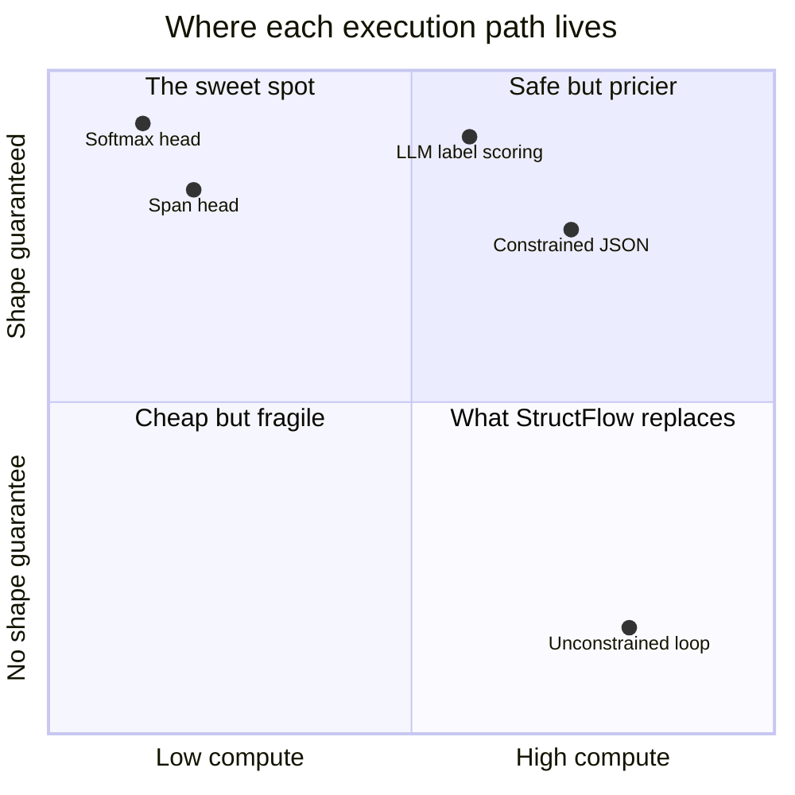
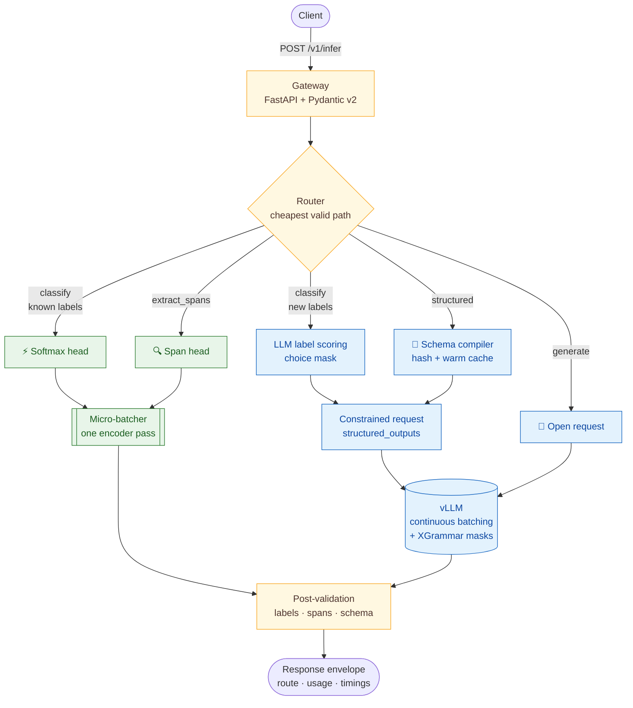
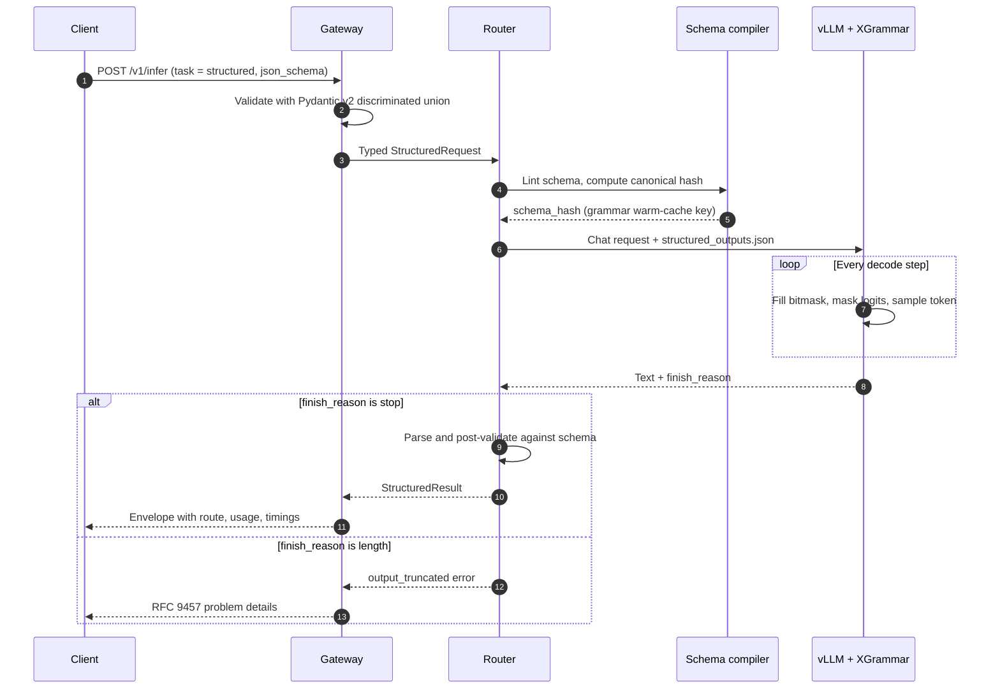
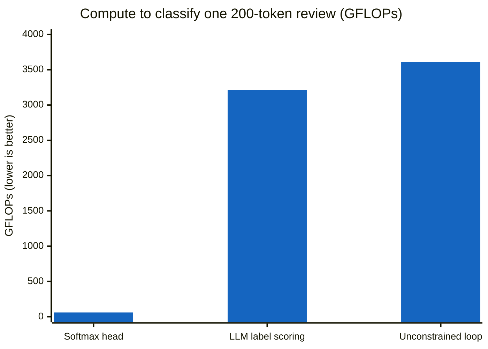
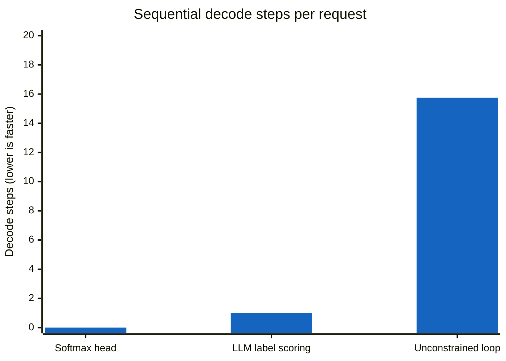
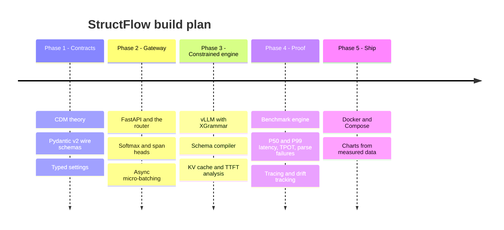

<div align="center">

# StructFlow

### Stop paying for essays when you asked for a checkbox.

**A high-throughput structured inference gateway. Every request goes down the cheapest path that still guarantees the shape of the answer.**


*The fastest token is the one you never generate.*

</div>

> [!IMPORTANT]
> StructFlow is being built in public, one phase at a time. **Today it is in Phase 1 (contracts).** The diagrams below describe the target architecture; the [roadmap](#roadmap) shows exactly what is real so far.

---

## The 10-second pitch

| You need… | A raw LLM gives you… | StructFlow gives you… |
|---|---|---|
| One label out of three | `Sure! Based on the review, I'd say the sentiment is positive.` | `positive`, from one forward pass of a small model |
| The people named in a support ticket | Three names, one of which it made up | Exact slices of your text, with character offsets |
| A JSON invoice record | `Here's the JSON: {"total": 42, "items": [` …and then it stops | JSON that always parses, enforced token by token |
| An open-ended answer | An open-ended answer | An open-ended answer (nothing to constrain) |

## Why this exists

Most LLM applications don't want prose. They want a **label**, a **list of entities**, or a **JSON object with exact fields**. The common pattern is to let a large model write freely, then dig the answer out of the text. That pattern has three costs:

- **It's slow.** Every generated token is a full pass through billions of parameters, and most of those tokens are filler.
- **It's expensive.** GPU time is spent writing sentences nobody reads.
- **It breaks, and the retries hurt the tail.** If 95% of responses parse, 1 in 20 requests runs twice. Your **P99 latency lands inside that retried group**, so it's at least double the normal latency.

StructFlow removes the loop instead of making it faster.

## The vision

1. **Contracts, not prompts.** The caller declares the shape of the answer: a label set, entity types, a JSON Schema, a regex or a grammar. The gateway owns the guarantee.
2. **The cheapest path that satisfies the contract.** A label from a fixed set never needs a decode loop. A JSON object never needs a retry loop.
3. **Grounded by construction.** Extracted entities are slices of the input, `text[start:end]`, never paraphrases.
4. **Measured, not claimed.** Every response says which path served it, how many forward passes it took and how long each stage ran. Benchmarks, not adjectives, decide the charts.
5. **Honest about the edges.** Truncation, distribution distortion and whitespace loops are tracked as metrics, not hidden.

## Four lanes, one contract

| Lane | Serves | Engine | Sequential decode steps | Shape guarantee |
|---|---|---|---|---|
| ⚡ **Softmax head** | Classification over a known label set | Encoder + linear layer + softmax | 0 | The output is one of the K labels |
| 🔍 **Span head** | Entity and span extraction | Token classification + offset mapping | 0 | Every span is exactly `text[start:end]` |
| 🧭 **Constrained generation** | JSON Schema, regex, choice, grammar | vLLM + XGrammar token bitmask | N (short) | The output parses, if generation finishes |
| 💬 **Open generation** | Open-ended questions | vLLM, no mask | N | None needed |

The constrained lane has a trick for classification when no local head knows the labels: **LLM label scoring.** If every label starts with a different token, a `choice` constraint with `max_tokens=1` turns the 8B model into a one-step K-way classifier.


<sub>Illustrative positioning, not measured data.</sub>

## Architecture


<sub>🟩 local encoder heads · 🟦 vLLM paths · 🟨 gateway logic</sub>

**How it stays fast under load**

- **The event loop never runs a model.** Encoder heads run behind an async micro-batcher on a dedicated executor. Requests are grouped for up to a few milliseconds, then served by one batched forward pass.
- **The gateway doesn't batch LLM requests.** vLLM's continuous batching already does that better. The gateway forwards requests concurrently over one shared HTTP client.
- **Backpressure is explicit.** A per-backend semaphore caps requests in flight. When saturated, the gateway answers `429`/`503` with `Retry-After` instead of letting vLLM's queue silently inflate time-to-first-token.
- **Abandoned requests free memory.** A client disconnect aborts the upstream generation, so its KV-cache blocks go back to the pool.
- **vLLM stays private.** It sits on an internal network that only the gateway can reach.

## Life of a structured request



## How the guarantee works

At every decode step, the grammar's current state decides which tokens are legal. Every other token's logit is set to −∞ before sampling:

```math
\tilde\ell_i=\begin{cases}\ell_i & i\in\mathcal{V}(s_t)\\ -\infty & \text{otherwise}\end{cases}
\qquad y_t\sim\mathrm{softmax}(\tilde\ell/\tau)
\qquad s_{t+1}=\delta(s_t,y_t)
```

- **Regex and choice** are regular languages. A finite-state machine handles them, and every state's mask can be precomputed.
- **Nested JSON** is context-free. It needs a stack (a pushdown automaton), so not every mask can be precomputed.
- **XGrammar's trick:** most tokens' validity depends only on the automaton's local position, so it precomputes and caches those per node. Only the few tokens that need the full stack are checked at runtime.

The mask itself is one bit per vocabulary entry:

| Model | Logit width (vocab) | int32 words per row | Bytes per row | 256 constrained rows per step |
|---|---:|---:|---:|---:|
| Llama-3.1-8B | 128,256 | 4,008 | ≈ 15.7 KiB | ≈ 4.1 MB |
| Qwen2.5-7B | 152,064 | 4,752 | ≈ 18.6 KiB | ≈ 4.9 MB |

Moving and applying the mask is cheap. The real costs are **CPU-side mask computation** for each constrained row and **grammar compilation on a cache miss**. That's why StructFlow hashes every schema canonically and keeps popular grammars warm.

<details>
<summary><b>The fine print: what the guarantee does not cover</b></summary>

1. **Truncation.** A response cut off by `max_tokens` is an invalid prefix. "Always parses" holds only for `finish_reason == "stop"`, so StructFlow returns an explicit `output_truncated` error and tracks truncation as its own metric.
2. **Distribution distortion.** Renormalizing at each step is not the same as conditioning on valid outputs. The mask enforces syntax; the prompt still has to carry the meaning, so the schema goes in the prompt too.
3. **Whitespace loops.** JSON allows unlimited whitespace, and a model can emit newlines until it hits the cap. StructFlow constrains whitespace.
4. **Syntax is not truth.** A schema-valid object can still be wrong, and some JSON Schema keywords may not be enforceable by a given backend. Every output is post-validated.

</details>

## Back-of-the-envelope: why the lanes matter

The scenario: classify the sentiment of a 200-token product review.




<sub>"Unconstrained loop" = free generation, parse, and retry on failure (~5% of requests). The softmax head has no decode bar because it takes exactly zero decode steps.</sub>

> [!NOTE]
> These are **analytical estimates, not benchmarks.** Assumptions: FLOPs ≈ 2 × parameters × tokens (attention ignored); Llama-3.1-8B ≈ 8.0B parameters; encoder ≈ 150M parameters; an unconstrained answer of ≈ 15 tokens; 95% parse success, so ≈ 1.05 attempts per request. **Phase 4 replaces every number here with measured results.**

**The takeaway:**
- The softmax head does **roughly 50–60× less compute** than either LLM path.
- LLM label scoring still pays for the prompt (prefill), but it collapses ~16 sequential decode steps into 1. There, the win is **latency**, not FLOPs.
- Prefix caching of the shared system prompt can shrink the prefill further.

## What Phase 4 will measure

| Metric | Why it matters |
|---|---|
| P50 / P99 end-to-end latency | The user-visible number, and the tail that retries destroy |
| Time to first token (TTFT) | Exposes grammar compilation on cache misses and queueing |
| Time per output token (TPOT) | Exposes per-step mask overhead |
| Throughput (requests/s, tokens/s) | Capacity per GPU |
| Structural parse failure rate | **Target: 0%** for `finish_reason == "stop"` |
| Truncation rate | The one way constrained output can still be invalid |
| Forward passes per request | The cleanest proxy for compute saved |
| Estimated GPU-seconds saved | Against an unconstrained generate-and-parse baseline |

## API preview

> [!TIP]
> These shapes are being finalized in Phase 1, and the endpoint lands in Phase 2. Values are illustrative.

**Classify with a local head**

```jsonc
// POST /v1/infer
{
  "task": "classify",
  "text": "Checkout was painless and the package arrived a day early.",
  "labels": ["positive", "negative", "neutral"]
}
```

```jsonc
// 200 OK
{
  "route": "softmax_head",
  "route_trail": ["softmax_head"],
  "degraded": false,
  "result": {
    "task": "classify",
    "labels": [
      { "label": "positive", "score": 0.97 },
      { "label": "neutral",  "score": 0.02 },
      { "label": "negative", "score": 0.01 }
    ]
  },
  "usage": { "prompt_tokens": 14, "completion_tokens": 0, "forward_passes": 1 },
  "timings": { /* queue_ms, inference_ms, total_ms: measured per request */ }
}
```

**Structured extraction with a JSON Schema**

```jsonc
// POST /v1/infer
{
  "task": "structured",
  "messages": [{ "role": "user", "content": "Extract the invoice: ACME Corp billed $1,240 on 2026-10-01." }],
  "constraint": {
    "type": "json_schema",
    "schema": {
      "type": "object",
      "properties": {
        "vendor": { "type": "string" },
        "amount_usd": { "type": "number" },
        "date": { "type": "string" }
      },
      "required": ["vendor", "amount_usd", "date"]
    }
  }
}
```

## Quickstart (what runs today)

```bash
git clone https://github.com/adibatwal7/structflow.git
cd structflow
python -m venv .venv && source .venv/bin/activate
python -m pip install -e ".[dev]"
cp .env.example .env
pytest
python -c "from structflow.config import get_settings; print(get_settings())"
```

**Configuration.** Settings are read from `STRUCTFLOW_*` environment variables or `.env`, and validated at startup. A bad value refuses to boot instead of misbehaving later.

| Variable | Default | Meaning |
|---|---|---|
| `STRUCTFLOW_VLLM_BASE_URL` | `http://localhost:8000/v1` | OpenAI-compatible vLLM endpoint (trailing `/` stripped) |
| `STRUCTFLOW_VLLM_API_KEY` | `EMPTY` | Must match `vllm serve --api-key`; stored as `SecretStr`, never logged |
| `STRUCTFLOW_MODEL_NAME` | `meta-llama/Llama-3.1-8B-Instruct` | Generative model served by vLLM |
| `STRUCTFLOW_REQUEST_TIMEOUT_S` | `60.0` | Upstream timeout in seconds (> 0) |
| `STRUCTFLOW_MAX_INFLIGHT_GENERATION` | `64` | Concurrent requests allowed at vLLM |
| `STRUCTFLOW_MICROBATCH_MAX_SIZE` | `8` | Max inputs per encoder forward pass |
| `STRUCTFLOW_MICROBATCH_MAX_WAIT_MS` | `5` | Max wait to fill a batch (0–100 ms) |
| `STRUCTFLOW_LOG_LEVEL` | `INFO` | `DEBUG`, `INFO`, `WARNING` or `ERROR` |

## Repository layout

```text
structflow/
├── pyproject.toml                ✅ packaging, extras, tooling
├── .env.example                  ✅ every setting, documented
├── docs/
│   ├── 01-cdm-theory.md          🚧 decoding regimes, masks, cost model
│   └── contracts/                🚧 exported JSON Schemas (contract diffs)
├── src/structflow/
│   ├── config.py                 ✅ typed, fail-fast settings
│   ├── schemas/                  🚧 the wire contract (Phase 1)
│   ├── engines/                  🗺️ GenerationBackend, vLLM backends, schema compiler (Phase 3)
│   ├── gateway/                  🗺️ FastAPI app, routes, middleware (Phase 2)
│   ├── routing/                  🗺️ policy table + router (Phase 2)
│   ├── heads/                    🗺️ encoder heads, micro-batcher (Phase 2)
│   └── telemetry/                🗺️ tracing, metrics, drift (Phase 4)
├── benchmarks/                   🗺️ benchmark_engine.py (Phase 4)
├── tests/unit/                   ✅ settings tests
└── deploy/                       🗺️ Dockerfile, docker-compose.yml (Phase 5)
```
<sub>✅ built · 🚧 in progress · 🗺️ planned</sub>

## Roadmap



**Phase 1 · Contracts** 🚧
- [x] Project scaffold: src layout, editable install, pytest, ruff, mypy
- [x] Typed, fail-fast settings with `STRUCTFLOW_*` variables and a `SecretStr` API key
- [ ] Wire schemas: common, constraints, requests, responses, errors
- [ ] Contract tests and exported JSON Schemas in `docs/contracts/`
- [ ] Theory write-up in `docs/01-cdm-theory.md`

**Phase 2 · Gateway and local heads**
- [ ] FastAPI gateway with a single `/v1/infer` endpoint
- [ ] Router policy table: cheapest path that satisfies the contract
- [ ] Softmax head and span head behind an async micro-batcher

**Phase 3 · Constrained engine**
- [ ] `GenerationBackend` protocol with vLLM HTTP and in-process backends
- [ ] Schema compiler: lint, canonical hash, grammar warm cache
- [ ] LLM label scoring lane
- [ ] Memory, KV-cache and TTFT analysis of masked decoding under concurrency

**Phase 4 · Proof**
- [ ] `benchmarks/benchmark_engine.py` against an unconstrained baseline
- [ ] Request-lifecycle tracing and payload drift tracking

**Phase 5 · Ship**
- [ ] Dockerfile and docker-compose: gateway + vLLM on a private network
- [ ] Replace the estimate charts above with measured ones

## Design decisions

| Decision | Why |
|---|---|
| The caller declares an explicit `task`; no ML intent routing | Deterministic, auditable, and adds zero latency to the hot path |
| Discriminated unions on `task` and `type` | Direct dispatch, precise error messages, clean OpenAPI |
| vLLM reached over HTTP by default | Separate crash domain, independent scaling, matches the Compose deployment |
| `schemas/` imports no torch or vLLM | Clients, CI and benchmarks can use the contract without a GPU |
| `output_truncated` is an error, never a result | Keeps "always parses" literally true |
| `STRUCTFLOW_` prefix and a `SecretStr` API key | No collisions with generic variables; keys never appear in logs |

## Standing on the shoulders of

- [vLLM](https://github.com/vllm-project/vllm): high-throughput serving with structured outputs
- [XGrammar](https://github.com/mlc-ai/xgrammar) and its [paper](https://arxiv.org/abs/2411.15100): fast grammar-constrained decoding
- [llguidance](https://github.com/guidance-ai/llguidance): an alternative structured-output backend
- [Pydantic](https://docs.pydantic.dev/), [FastAPI](https://fastapi.tiangolo.com/) and [Hugging Face Transformers](https://github.com/huggingface/transformers)

---

<div align="center">

Built in public by [Aditya Batwal](https://github.com/adibatwal7) as a deep dive into inference systems.<br/>
If the idea resonates, ⭐ the repo and follow along as each phase lands.

</div>
