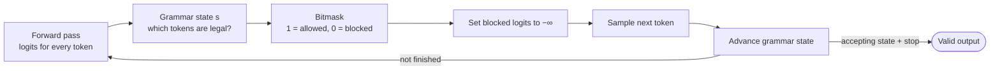
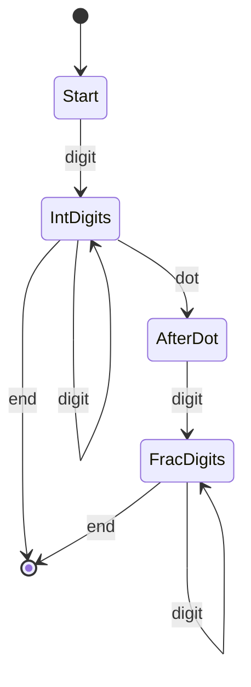
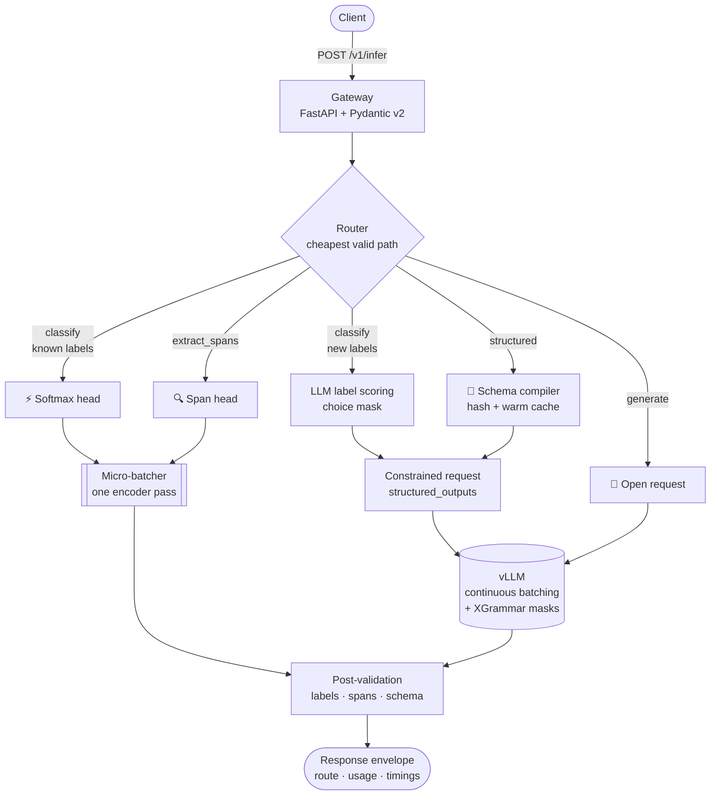
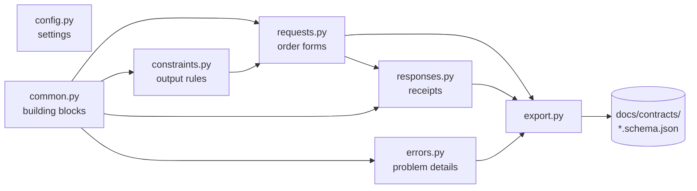

# Constrained Decoding Models: Theory and the Phase 1 Design

> **What this is:** the companion document to Phase 1 of StructFlow. It explains the ideas the project is built on, then walks through every design decision in the Phase 1 code and *why* it exists.
>
> **Reading time:** about 30 minutes.
>
> **A note on numbers:** anything marked *estimate* is back-of-the-envelope arithmetic, with its assumptions stated. Phase 4 replaces every estimate with measurements.

---

## TL;DR

- Most LLM applications don't want prose. They want a **label**, a **list of entities**, or **JSON with exact fields**.
- The default approach is "let a big model write freely, then parse the answer out." That approach is **slow** (most generated tokens are filler), **expensive** (each token is a full pass through billions of weights), and **fragile** (malformed output triggers retries, and the retries wreck tail latency).
- StructFlow treats the *shape of the answer* as a contract. It routes each request down the **cheapest path that still guarantees that shape**:
  - a small classifier for fixed labels,
  - a span tagger for entities,
  - grammar-masked generation for JSON,
  - plain generation only when nothing can be constrained.
- Grammar-constrained decoding guarantees **syntax**, not **truth**, and only **if generation finishes**. StructFlow treats truncation as an explicit error and never hides a fallback.
- Phase 1 built the **contract**:
  - typed, validated request and response shapes,
  - an error format,
  - published JSON Schemas,
  - 156 tests.

---

## 1. The problem: "generate, then parse"

Suppose you need the sentiment of a product review. The common pattern is:

1. Send the review to a 7–8B parameter model with "Answer positive, negative or neutral."
2. The model writes `Sure! Based on the review, the sentiment is **positive**.`
3. Your code hunts for one of the three words in that sentence.
4. If parsing fails (the model wrote "upbeat," or broke the JSON), retry.

There are three costs.

**It's slow.** The model produces text one token at a time, and each token needs a full pass through the network (section 3). Fifteen tokens of filler means fifteen sequential passes.

**It's expensive.** Every one of those passes reads billions of weights.

**It's fragile, and the retries hurt the slowest requests most.** If each attempt parses successfully with probability $p$, and attempts are independent:

```math
\mathbb{E}[\text{attempts}] = \frac{1}{p}
\qquad
P(\text{attempts} \ge k) = (1-p)^{k-1}
```

| Parse success rate $p$ | Average attempts | Requests needing ≥ 2 attempts | Requests needing ≥ 3 attempts |
|---|---:|---:|---:|
| 0.95 | 1.053 | 5% | 0.25% |

The average looks harmless: 5% extra work. **The tail does not.**
- 5% of requests run at least twice. That's more than 1%, so your **P99 latency falls inside the retried group**, and P99 is at least double the latency of a single attempt.
- Customers notice P99, not the average.

StructFlow's approach is to **remove the loop**, not to make the loop faster.

---

## 2. What "CDM" means in this project

"Constrained Decoding Model" is not a standard textbook term, so here is the precise definition this project uses:

> **CDM:** an execution path whose **output space is fixed before inference starts**.

Under that umbrella there are two very different mechanisms:

| Family | What runs | How the output space is fixed |
|---|---|---|
| **Non-autoregressive heads** | One forward pass of a small encoder | The output *is* a choice among K labels, or a set of positions in the input. Nothing is generated |
| **Grammar-constrained decoding** | A normal generate-one-token-at-a-time LLM | At every step, tokens that would break the grammar are blocked before sampling |

Being precise about this matters. A softmax classifier doesn't *decode* anything; it scores. Grammar masking does decode; it just can't go off the rails. They have different costs, different failure modes, and different guarantees.

---

## 3. How an LLM produces text (the baseline)

### 3.1 Prefill and decode

A decoder-only LLM (Llama, Qwen) models text one token at a time:

```math
p(y \mid x) = \prod_{t=1}^{N} p(y_t \mid y_{<t}, x)
```

A request runs in two phases with **different bottlenecks**:

| Phase | What happens | Bottleneck |
|---|---|---|
| **Prefill** | All prompt tokens are processed in parallel in one big pass. This produces the first output token and fills the KV cache | **Compute.** Lots of matrix math per byte of weights read |
| **Decode** | One new token per pass, N times in sequence | **Memory bandwidth.** Every step re-reads all the weights to produce one token |

### 3.2 Why decode is memory-bound

At small batch sizes, each decode step must stream every weight from GPU memory. A worked example:

- Llama-3.1-8B has ≈ 8.03 B parameters. In bf16 (2 bytes each), that's **≈ 16.1 GB of weights**.
- An H100 SXM reads memory at ≈ 3.35 TB/s.
- So the floor is **16.1 GB ÷ 3.35 TB/s ≈ 4.8 ms per decode step** at batch size 1, before any other overhead. (Qwen2.5-7B: ≈ 4.5 ms.)

Batching helps, because one read of the weights serves every request in the batch. That's why vLLM's **continuous batching** matters, and why StructFlow never re-batches LLM traffic itself.

### 3.3 The two formulas to remember

```math
\text{latency} \approx \text{TTFT} + N_{\text{out}} \times \text{TPOT}
\qquad\qquad
\text{FLOPs} \approx 2 \times \text{parameters} \times \text{tokens}
```

- **TTFT** (time to first token) is dominated by prefill and queueing.
- **TPOT** (time per output token) is dominated by decode.
- Every output token you *don't* generate saves one TPOT of latency and a full pass of compute.

The **KV cache** stores each token's attention keys and values, so they aren't recomputed. It grows with every token in flight, and it is the main thing limiting how many requests vLLM can batch at once. (Phase 3 measures this.)

---

## 4. Non-autoregressive heads (zero generation)

### 4.1 Classification: one softmax

Run the text through an encoder (a BERT-style model) once. Take a summary vector $h$, and score K labels:

```math
p(k \mid x) = \mathrm{softmax}(W h + b)_k \qquad W \in \mathbb{R}^{K \times d}
```

- **Passes:** exactly one forward pass. No loop.
- **Output space:** exactly the K labels. An invalid answer is **impossible by construction**: there's no way to output "upbeat."
- **Multi-label** (several labels can apply at once): use an independent sigmoid per label, plus a threshold. That's why `ClassifyRequest` only allows `threshold` when `multi_label` is true.

### 4.2 Span extraction: label the input, don't generate

**Token classification** tags every input token (for example, B-PER / I-PER / O), so its output is a score for every token and tag: $Z \in \mathbb{R}^{L \times |T|}$. The tokenizer's **offset mapping** then converts token positions back to character positions in the original text.

```text
text  = "  Alice met Bob"
          ^^^^^
span  = start=2, end=7, label=PER   →   text[2:7] == "Alice"
```

The key property: **every extracted entity is literally a slice of the input**, so it's **grounded by construction**. A generative model can "extract" a name that isn't in the text. A span head can't.

This is also why StructFlow **never strips whitespace** from input text. Silently removing those two leading spaces would shift every offset by 2, and the client would highlight the wrong letters.

### 4.3 The price: fixed label sets

A trained head knows only the labels it was trained on. Options for labels chosen at request time:
- **NLI zero-shot classification:** one forward pass per label, so K passes.
- **Bi-encoders:** one pass for the text, with label embeddings cached.
- **GLiNER-style span models:** open-ended entity types in a single pass.
- **Or fall back** to the LLM with a `choice` constraint (section 5.7).

### 4.4 Cost (*estimate*)

Classifying a 200-token review:
- **≈ 150 M-parameter encoder:** 2 × 150 M × 200 ≈ **60 GFLOPs**.
- **8 B LLM, prefill alone:** 2 × 8 B × 201 ≈ **3,216 GFLOPs**.

The encoder does roughly **50× less work**, and it skips the decode loop entirely.

---

## 5. Grammar-constrained decoding

### 5.1 The core mechanism: mask, then sample

Some outputs truly need generation, like a JSON object built from free text. Here the trick is to **block invalid tokens at every step**:

```math
\tilde{\ell}_i =
\begin{cases}
\ell_i & \text{if } i \in \mathcal{V}(s_t) \\
-\infty & \text{otherwise}
\end{cases}
\qquad
y_t \sim \mathrm{softmax}(\tilde{\ell} / \tau)
\qquad
s_{t+1} = \delta(s_t, y_t)
```

- $\ell$ is the logit vector: one score per vocabulary token.
- $s_t$ is the grammar's current state, and $\mathcal{V}(s_t)$ is the set of tokens allowed in that state.
- Setting a logit to −∞ makes that token's probability exactly 0.
- After sampling, the grammar advances to its next state, $\delta(s_t, y_t)$.



**The guarantee:** every prefix the model produces is a valid prefix of the grammar. So **if generation stops in an accepting state, the output is in the language.**

### 5.2 A walk-through

Schema: `{"type": "object", "properties": {"vendor": {"type": "string"}}, "required": ["vendor"], "additionalProperties": false}`

| Output so far | Allowed next (examples) | Blocked (examples) |
|---|---|---|
| *(nothing)* | `{` | `Sure`, `Here`, `"` |
| `{` | `"` (the start of `"vendor"`) | `}`, because `vendor` is required |
| `{"vendor": "` | almost any string characters, or `"` | raw control characters |
| `{"vendor": "ACME"` | `}` | `,` (no other properties are allowed) |

Real tokens span several characters (`{"` is often one token). So the mask asks, for each token: "can *all* of this token's bytes be consumed from the current state?"

### 5.3 Regular vs. context-free: why JSON is harder than regex

**A regex is a finite-state machine (FSM).** For `[0-9]+(\.[0-9]+)?`:



There are finitely many states, so **every state's mask can be computed once, ahead of time**. At runtime, a mask is a lookup.

**Nested JSON is context-free, not regular.** To know whether `}` is legal, you have to know how many objects and arrays are currently open. That needs a **stack**, which makes the machine a **pushdown automaton (PDA)**. The stack can grow without limit, so you **can't precompute a mask for every configuration**.

**This connects directly to Phase 1 code.**
- vLLM's xgrammar and guidance backends use Rust-style regex, which deliberately has **no lookarounds and no backreferences**.
- Those are exactly the features that break the finite-state guarantee.
- Python's `re` accepts them, so `RegexConstraint` rejects them up front, instead of letting them fail later on the GPU server.

### 5.4 How XGrammar makes PDA masking fast

XGrammar (Dong et al., 2024) compiles grammars into a **byte-level pushdown automaton**, and splits the vocabulary at each automaton node:

- **Context-independent tokens.** Most tokens: whether they're valid depends only on the current node (the top of the stack). XGrammar **precomputes** these and stores them in an *adaptive token mask cache*, keyed by node.
- **Context-dependent tokens.** The few whose validity depends on the whole stack. These are checked at runtime by running the automaton.

At runtime, the mask is a cache lookup plus a small check. XGrammar also runs mask generation alongside the GPU's forward pass, so the CPU work can hide behind GPU time.

A follow-up paper, *XGrammar 2*, targets grammars that change at runtime (agent workloads). It builds mask caches just-in-time, and switches to an Earley parser for complex grammars.

### 5.5 The bitmask and its real costs

The mask is one bit per vocabulary token, packed into 32-bit integers:

```math
\text{bytes per row} = 4 \times \left\lceil \frac{V}{32} \right\rceil
```

| Model | Vocabulary $V$ | int32 words | Bytes per row | 256 constrained rows per step |
|---|---:|---:|---:|---:|
| Llama-3.1-8B | 128,256 | 4,008 | 16,032 (≈ 15.7 KiB) | ≈ 4.10 MB |
| Qwen2.5-7B | 152,064 | 4,752 | 19,008 (≈ 18.6 KiB) | ≈ 4.87 MB |

Copying the mask to the GPU and applying it (one pass over the logits) is cheap. **The real costs are elsewhere:**

1. **CPU mask computation** for every constrained request, every step. It grows with the number of constrained requests in the batch, and it can slow down *everyone's* step.
2. **Grammar compilation** the first time a schema is seen. That adds directly to TTFT.

That's why Phase 1 gives every constraint a **cache key**, so Phase 3 can compile each distinct grammar once and reuse it.

### 5.6 How vLLM exposes this

- Since v0.12.0, structured output is requested with one `structured_outputs` object. Its keys are `json`, `regex`, `choice`, `grammar` or `structural_tag`. The old `guided_*` fields were removed.
- The backend is chosen with `--structured-outputs-config.backend`. The default is `auto`; you can also pin `xgrammar` or `guidance`.
- Internally, an engine-level `StructuredOutputManager`:
  - compiles grammars in a **background thread pool**, so compilation doesn't block the scheduler;
  - at each step, fills **one batched bitmask** with a row per constrained request;
  - applies that bitmask to the logits before sampling.
- A grammar that fails to compile fails **only that request**.

```python
client.chat.completions.create(
    model=model,
    messages=[{"role": "user", "content": "Extract the invoice: ACME billed $1,240"}],
    extra_body={"structured_outputs": {"json": Invoice.model_json_schema()}},
)
```

Constrained and unconstrained requests **share the same continuous batch**. The mask is only applied to the rows that need it.

### 5.7 A trick: LLM label scoring

When no local head knows the labels, send a `choice` constraint. If every label starts with a different token, the **first generated token already identifies the label**. With `max_tokens=1`, the 8B model becomes a one-step K-way classifier.
- It still pays for prefill (≈ 3,216 GFLOPs in our example).
- But it collapses ~16 sequential decode steps into 1. The win is **latency**, not compute.

---

## 6. What the guarantee does *not* cover

### 6.1 Truncation

If generation hits `max_tokens` mid-object, you get a valid *prefix*, `{"vendor": "AC`, and that isn't valid JSON. "Always parses" holds **only when `finish_reason == "stop"`**. StructFlow's answer:
- a truncated structured output becomes the error `output_truncated`, never a result;
- truncation is tracked as its own metric.

### 6.2 Distribution distortion

Renormalizing at every step is **not** the same as asking the model for its best *valid* answer. A toy example, where the grammar requires the second token to be `X`:

| | First token A | First token B |
|---|---|---|
| Model: $p(\text{first})$ | 0.6 | 0.4 |
| Model: $p(X \mid \text{first})$ | 0.01 | 0.9 |
| **Step-by-step masking** produces | **AX 60%** | **BX 40%** |
| **True** $p(y \mid y \text{ valid})$ | AX 1.6% | **BX 98.4%** |

At step 1, the mask allows both A and B (each can still lead to a valid output), so the model picks A 60% of the time. Then it's *forced* into X, a token it considered very unlikely after A.

**The lesson:** the mask enforces **syntax**. The **prompt** still has to steer the meaning, so always describe the schema in the prompt as well.

### 6.3 Whitespace loops

JSON allows unlimited whitespace between tokens. A model can emit newlines until it hits `max_tokens`. Whitespace has to be constrained too (Phase 3).

### 6.4 Valid syntax isn't the same as truth

A schema-valid invoice can still have the wrong amount. And a backend may not be able to enforce every JSON Schema keyword. So **every output is validated again** after generation.

---

## 7. StructFlow's routing idea

**The rule: send each request down the cheapest path that still satisfies its contract.** The caller states the task explicitly. There's no ML "intent router" in the hot path, because it would add latency, randomness and a new way to fail.

| Task | Preferred route | Fallback | Never |
|---|---|---|---|
| `classify` | softmax head (the labels are ones it knows) | LLM label scoring | free generation + regex parsing |
| `extract_spans` | span head | constrained JSON spans + grounding check | — |
| `structured` | constrained generation | free generation + validation, **only if the caller opts in**, and marked `degraded` | silent fallback |
| `generate` | free generation | — | — |



**Phase 2 preview: how it stays fast.**
- Model code never runs on the async event loop. Encoder heads sit behind a **micro-batcher**: it groups requests for up to `microbatch_max_wait_ms` (5 ms), then runs one batched forward pass in a dedicated thread.
- A semaphore caps the requests in flight to vLLM (`max_inflight_generation`, 64). When full, the gateway answers **503 with `Retry-After`**, instead of letting vLLM's queue silently inflate TTFT.
- A client disconnecting aborts its upstream generation, which frees KV-cache blocks.

---

## 8. What we built in Phase 1, and why each rule exists

Phase 1 built the **contract**: the exact shapes of everything that crosses the API boundary. Nothing in it needs a GPU.



### 8.1 `config.py`: typed settings that fail fast

| Rule | Why |
|---|---|
| Every setting is read from a `STRUCTFLOW_*` environment variable | Generic names like `TIMEOUT` collide with other tools in containers |
| The API key is a `SecretStr` | `print(settings)` and log lines show `**********`, never the key |
| Bad values stop the app at startup | A negative timeout should never boot and misbehave later |
| `microbatch_max_wait_ms = 5` (max 100) | This wait is added to *every* classification request, so it must stay small next to a ~10 ms forward pass |
| `max_inflight_generation = 64` | It caps how many requests vLLM can batch. Too low leaves the GPU idle. Phase 4 tunes it |
| `get_settings()` is cached, with no settings object created at import time | Importing a schema must never read the environment |

### 8.2 `common.py`: shared building blocks

| Rule | Why |
|---|---|
| `StrictModel`: `extra="forbid"` | A typo like `"lables"` is an error, instead of being silently ignored |
| `StrictModel`: `frozen=True` | Once validated, nothing downstream can change a request |
| Sequences are `tuple`, not `list` | `frozen` only blocks *replacing* a field. A list inside a frozen model can still be modified |
| Text is checked for blankness but **never stripped** | Span offsets (section 4.2) |
| `strict=True` on number fields | Without it, `{"seed": true}` silently became `seed = 1`, and `"512"` became `512` |
| `SamplingParams` uses OpenAI and vLLM field names | Values pass straight through in Phase 3, with no renaming |
| `temperature` defaults to 0 | Structured tasks want the model's most likely answer |
| `StrEnum` for `TaskType`, `Route`, `FinishReason` | Enum values are real strings, so they turn into plain JSON |

### 8.3 `constraints.py`: the output rules

| Rule | Why |
|---|---|
| A discriminated union on `type` | Validation goes straight to the right variant, and error messages only mention that variant |
| Schema ≤ 64 KB and ≤ 16 levels deep | Compile cost grows with size, so a giant schema could tie up the server |
| Only local `$ref` (starting with `#`) | A remote ref would make the server fetch URLs chosen by a stranger (SSRF), and results could differ between requests |
| The root must be `"type": "object"` | The result is always a JSON object, which keeps responses simple |
| Regex: reject lookarounds and backreferences, then `re.compile` | Section 5.3: the backend's regex dialect can't run them |
| Choice: at least 2 entries, all unique | One choice isn't a choice. Duplicates break the label mapping |
| Grammar: must define `root ::=` | Every grammar needs an entry rule |
| `cache_key()` hashes the constraint's JSON **without sorting keys** | Field order changes the compiled grammar, and output order matters (e.g. `reasoning` before `answer`). **Our first design sorted the keys. That was a bug: two different grammars would have shared one cache entry** |
| `cache_key()` is a method, not a stored value | A frozen model's dict can still be modified, so computing the key fresh means it can never be out of date |
| Callers must send `"schema"`, while the code uses `json_schema` | A field named `schema` clashes with an old `BaseModel` method. Dumping needs `by_alias=True` |
| **Layered validation** | These checks are cheap (microseconds). The *authoritative* check is the backend's compile, once per cache key, in Phase 3 |

### 8.4 `requests.py`: the order forms

| Rule | Why |
|---|---|
| Four request types, discriminated on `task` | One endpoint, with the type deciding the shape |
| Plain string tags (`Literal["classify"]`) | Enum tags put `<TaskType.CLASSIFY: 'classify'>` into client error messages |
| Tags have **no default** | With a default, the exported JSON Schema marked `task` optional, even though the API rejects requests without it |
| `top_k ≤ len(labels)`; `threshold` requires `multi_label` | Cross-field rules, checked by `model_validator(mode="after")` |
| A system message only first; the last message must be from the user | These become the chat prompt. A trailing assistant message means "continue this text," a different feature |
| `allow_unconstrained_fallback` defaults to `False` | A silent fallback would break the "always matches the schema" promise |
| `request_id` limited to `[A-Za-z0-9._-]{1,64}` | It ends up in logs and headers, so newlines could forge log lines (log injection) |
| At most 16 metadata items | Tags for Phase 4 drift tracking, capped |

### 8.5 `responses.py`: the receipts

| Rule | Why |
|---|---|
| Every response reports `route` and `route_trail` | You can always see *how* an answer was produced |
| `ALLOWED_ROUTES` written into the contract | The routing policy from section 7 is enforced, so a `span_head` can never "answer" a `classify` request |
| `degraded` is true **exactly when** a structured task used the free-generation fallback | A fallback can never happen silently |
| `StructuredResult` has **no `finish_reason`** | Truncation is an error, so the result type can't even express it. This is **making illegal states unrepresentable** |
| Labels must be sorted by score, highest first, and are **checked, not re-sorted** | If the router gets the order wrong, a test should catch it instead of the schema hiding it |
| Span: `end > start`, and `len(text) == end − start` | The parts of grounding the schema can check on its own. Comparing against the original text happens in Phase 2 |
| `Usage.forward_passes` and `Timings` | The raw numbers Phase 4 needs to prove the savings |

### 8.6 `errors.py`: one error format (RFC 9457)

| Code | Status | Why this status |
|---|---|---|
| `validation_error`, `constraint_compile_failed`, `output_truncated` | 422 | The request can't be served as written, and the client can fix it (for truncation, by raising `max_tokens`) |
| `backend_saturated` | **503**, not 429 | 429 means "*you* are sending too much." Saturation means "*we* are full." Phase 2 adds `Retry-After` |
| `upstream_timeout` | 504 | vLLM didn't answer in time |
| `internal_error` | 500 | A bug on our side |

- **Factory classmethods** (`from_code`, `from_validation_error`) make the wrong status impossible to type.
- **Privacy:** by default, Pydantic's `errors()` includes the client's original `input`. `from_validation_error` uses `include_input=False`, so a rejected request is never echoed back, and neither is any personal data in it.

### 8.7 `export.py` and `docs/contracts/`: the contract as files

| Rule | Why |
|---|---|
| Requests exported in `validation` mode; responses and errors in `serialization` mode | Requests describe what clients may *send*; responses describe what we *send back* |
| No `sort_keys` | Pydantic's output is already deterministic, its order follows the code, and field order has meaning |
| A **snapshot test** compares the committed files to freshly generated ones | Any API change needs a deliberate, reviewable commit |
| An **agreement test** checks that JSON Schema and Pydantic accept and reject the same examples | It catches drift between the published contract and the real one |
| `uniqueItems` hints on label, entity and choice lists | Lets JSON Schema see a rule that otherwise lives only in Python code |
| `docs/contracts/README.md` lists the server-only rules | Some rules (non-blank text, conversation order…) can't be written in JSON Schema at all |

### 8.8 Four principles that kept coming up

1. **Check data, don't change it.** Validators raise; they never quietly fix things.
2. **Make illegal states unrepresentable.** If something should never happen, design the type so it *can't* be written down.
3. **Validate in layers.** Cheap checks at the edge; the expensive authoritative check once, in the backend.
4. **Contracts are code.** Generated, versioned, diffed and tested.

---

## 9. Engineering lessons from Phase 1 (good interview stories)

**A test file that never ran.** `tests_constraints.py` doesn't match pytest's `test_*.py` naming pattern, so it was silently skipped. The suite stayed "green" at 68 passing while `constraints.py` crashed on import.
→ *After adding tests, check that the passing count goes up.*

**The test that compared strings.** `json.dumps` puts a space after `:` and `,`, so two identical dicts produced different strings.
→ *Compare parsed data, not serialized text.*

**The hidden `.pth` file (a real debugging story).**
- *Symptom:* every test file failed at import with `No module named 'structflow'`, yet `pydantic` imported fine in the same environment.
- *Diagnosis:* when *every* file fails at once, suspect the environment, not the code. The package was installed, but its link file was being skipped.
- *Root cause:* since Python 3.13, startup **silently skips `.pth` files that macOS has marked hidden** (`UF_HIDDEN`). `python -v` shows `Skipping hidden .pth file`.
- *Fix:* `chflags nohidden .venv/lib/python3.14/site-packages/*.pth`. Reinstalling recreates the file, so it can come back. Moving the project out of Desktop is the lasting fix.

**The cache key that sorted its keys.** It looked like good practice to make the hash ignore key order, but field order changes the compiled grammar.
→ *Before you normalize something, ask whether the thing you're normalizing away carries meaning.*

**The schema that said `task` was optional.** Defaults on the tag fields leaked into the exported JSON Schema. The agreement test exposed it.
→ *Test the published contract, not just the code.*

---

## 10. Back-of-the-envelope numbers (*estimates*)

Scenario: classify one 200-token review.

| Path | Compute (GFLOPs) | Sequential output tokens | Shape guarantee |
|---|---:|---:|---|
| Softmax head (≈ 150 M encoder) | ≈ 60 | 0 | Always one of the K labels |
| LLM label scoring (8 B, `choice`) | ≈ 3,216 | 1 | Always one of the choices |
| Free generation + parse (8 B, ≈ 15 output tokens, 5% retries) | ≈ 3,612 | ≈ 15.75 | None |

Assumptions: FLOPs ≈ 2 × parameters × tokens (attention ignored), 8.0 B parameters, a 150 M encoder, 15 output tokens, 1.05 attempts per request.

---

## 11. Open questions for Phase 4 (and what would prove us wrong)

| Question | We'd be wrong if… |
|---|---|
| Does constrained JSON beat free generation + parse on P99 latency? | Mask and compile overhead outweighs the retries we remove |
| How much does grammar compilation add to TTFT on a cache miss vs. a hit? | Compilation is negligible, which would make the warm cache unnecessary |
| Does adding constrained requests slow the free-generation requests sharing the batch? | Per-step CPU mask work turns out to be invisible next to GPU time |
| Is the parse failure rate really 0% for `finish_reason == "stop"`? | Any stop-terminated output fails schema validation |
| How often do structured outputs get truncated at realistic `max_tokens`? | Truncation is frequent enough to need a different default |
| Is the softmax head's accuracy close enough to the LLM's for the latency win to be worth it? | The accuracy gap is too large for real use |

---

## 12. Self-check

<details>
<summary><b>1. Why does constraining the output not make each generated token faster?</b></summary>

Each token still needs a full forward pass, and the mask adds a little work on top. The savings come from generating **fewer tokens** and from **removing retries**, not from faster steps.
</details>

<details>
<summary><b>2. Why can every regex mask be precomputed, but not every JSON mask?</b></summary>

A regex is a finite-state machine with finitely many states, so you can compute each state's allowed tokens once. Nested JSON needs a stack (a pushdown automaton), and the stack can grow without limit, so there are unboundedly many configurations. XGrammar precomputes the part that depends only on the current node, and checks the rest at runtime.
</details>

<details>
<summary><b>3. How many bytes per step is the bitmask for 256 constrained requests on Qwen2.5 (vocabulary 152,064)?</b></summary>

152,064 ÷ 32 = 4,752 words. × 4 bytes = 19,008 bytes per row. × 256 rows = **4,866,048 bytes ≈ 4.87 MB** per step.
</details>

<details>
<summary><b>4. Why is a span from a token-classification head guaranteed to exist in the input, while a generated span isn't?</b></summary>

The head labels **positions in the input**, so its output is a slice, `text[start:end]`, by construction. A generator writes **new tokens**, which may paraphrase, misspell or invent text that isn't in the input.
</details>

<details>
<summary><b>5. Why did we remove the default from the <code>task</code> field?</b></summary>

With a default, Pydantic's exported JSON Schema listed `task` as optional, but the discriminated union requires it. Clients generating code from the published schema would have been misled. A discriminator tag must always be required.
</details>

---

## Glossary

| Term | Meaning |
|---|---|
| **Autoregressive** | Generating one token at a time, each conditioned on the ones before it |
| **Prefill / decode** | Processing the prompt in parallel / generating output tokens one by one |
| **TTFT / TPOT** | Time to first token / time per output token |
| **KV cache** | Stored attention keys and values for tokens already processed; the main memory cost of serving |
| **Continuous batching** | vLLM adding and removing requests from a running batch at every step |
| **Logits** | Raw scores per vocabulary token, before softmax |
| **Bitmask** | One bit per vocabulary token: 1 = allowed, 0 = blocked |
| **FSM / PDA** | Finite-state machine (enough for regex) / pushdown automaton, a state machine plus a stack (needed for nested JSON) |
| **Discriminated union** | A union whose variant is chosen by a tag field (`task`, `type`) |
| **Problem details** | The RFC 9457 standard JSON shape for API errors |
| **Snapshot (golden) test** | A test that compares generated output to a committed file |

---

## References

- Dong et al., *XGrammar: Flexible and Efficient Structured Generation Engine for Large Language Models* (2024). <https://arxiv.org/abs/2411.15100>
- *XGrammar 2: Dynamic and Efficient Structured Generation Engine for Agentic LLMs* (review). <https://www.themoonlight.io/en/review/xgrammar-2-dynamic-and-efficient-structured-generation-engine-for-agentic-llms>
- vLLM documentation: *Structured Outputs.* <https://docs.vllm.ai/en/stable/features/structured_outputs/>
- vLLM API reference: `vllm.v1.structured_output`. <https://docs.vllm.ai/en/latest/api/vllm/v1/structured_output/>
- vLLM documentation: *OpenAI-Compatible Server.* <https://docs.vllm.ai/en/v0.30.0/serving/online_serving/openai_compatible_server/>
- RFC 9457, *Problem Details for HTTP APIs.* <https://www.rfc-editor.org/rfc/rfc9457>
- CPython issue #113356: skipping hidden `.pth` files. <https://github.com/python/cpython/issues/113356>
- JSON Schema Draft 2020-12. <https://json-schema.org/draft/2020-12>
- Pydantic documentation: unions and discriminated unions. <https://docs.pydantic.dev/latest/concepts/unions/>
