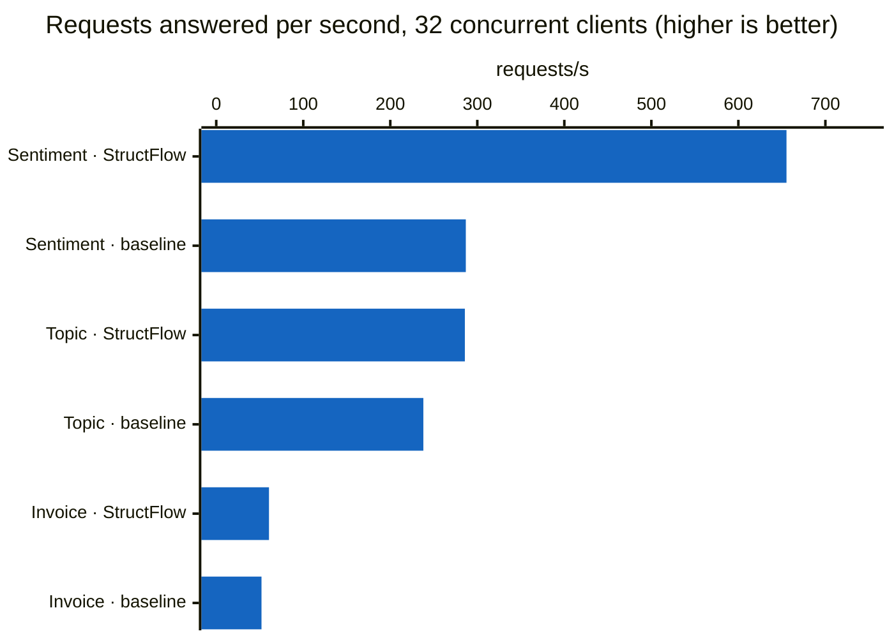
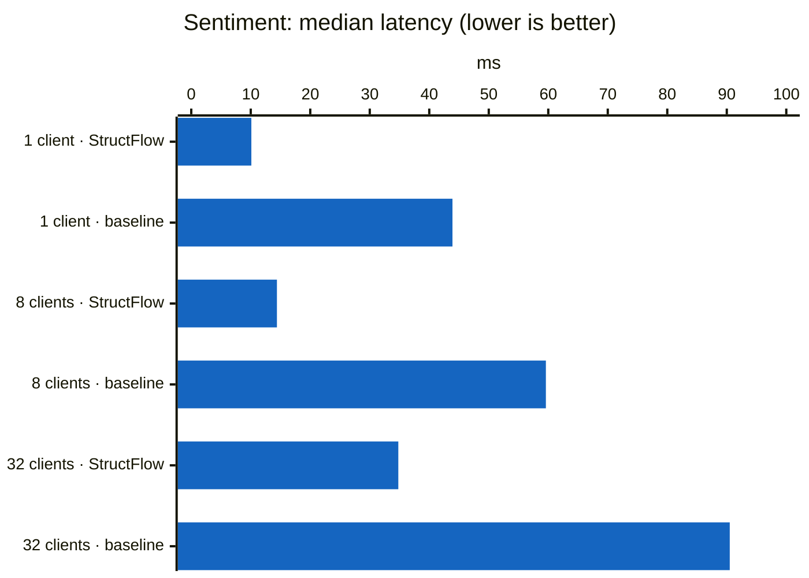
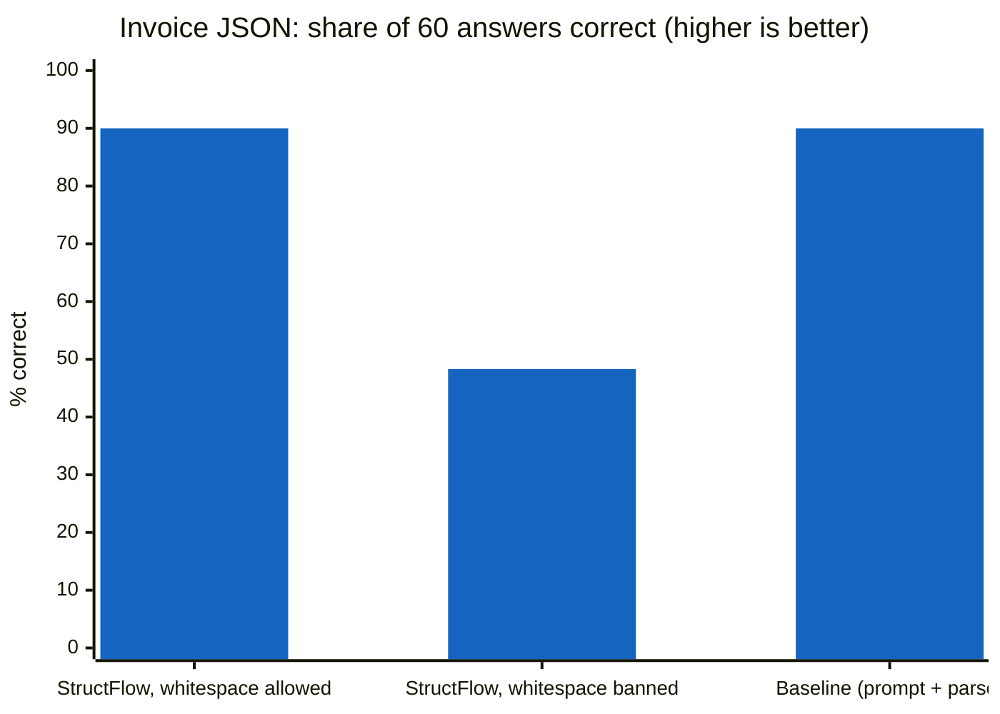

# What I measured

Real numbers from running StructFlow, as each phase lands. Every claim here comes from an experiment you can repeat; the command is next to it.

> **Scope:** Phases 2 and 3 are single requests and small experiments: they show *what is true*. Phase 4 (sections 9 to 11) is a benchmark against the usual prompt-and-parse approach, at several concurrency levels. Each Phase 4 configuration ran once, so small differences can be noise.

---

## Setup

| | Phase 2 (local) | Phase 3 (GPU) |
|---|---|---|
| Hardware | MacBook (Apple silicon, `mps`) | 1 × NVIDIA RTX 4090, 24 GB (RunPod) |
| Models | `distilbert-base-uncased-finetuned-sst-2-english` (softmax head), `dslim/distilbert-NER` (span head) | `meta-llama/Llama-3.1-8B-Instruct`, bf16 |
| Serving | StructFlow gateway (uvicorn) | vLLM 0.32.0, XGrammar backend, `--max-model-len 8192`, `--gpu-memory-utilization 0.90` |
| Network | in-process | gateway on the Mac → SSH tunnel → vLLM bound to `127.0.0.1` on the pod |

Step 3.5 (section 8) ran on a second RTX 4090 pod after a RunPod migration, with the same vLLM 0.32.0.

---

## Phase 2: local heads and the gateway

### Micro-batching pays off

64 sentiment requests through the softmax head on `mps`:

| | Time |
|---|---|
| One at a time | 1,430 ms |
| Micro-batched | 596 ms |
| **Speed-up** | **2.4×** |

### A bounded queue protects the tail

Open-loop load test, 400 requests/s for 10 s (`python -m structflow.bench.load`). Latency is measured from when each request *was due*, so a slow server can't hide its own queueing (no coordinated omission).

| Queue limit | Answered | Rejected (503) | p50 | p99 |
|---:|---:|---:|---:|---:|
| 16 | 3,648 | 352 | 57 ms | 80 ms |
| 256 | 3,910 | 90 | 186 ms | 782 ms |

**Takeaway:** a big queue answers 7% more requests but makes the p99 almost **10× worse**. Requests wait in line instead of failing fast. Little's law predicts this: time waiting = queue length ÷ throughput.

---

## Phase 3: vLLM behind the gateway

### 1. Every route works on real models

| Request | Route taken (`route_trail`) | Answer | Time |
|---|---|---|---:|
| Sentiment, labels `POSITIVE/NEGATIVE` | `softmax_head` | NEGATIVE, 0.9998 | 132 ms (warm) |
| Topic, labels `sports/politics/technology` | `softmax_head` → `llm_label_scoring` | sports | 602 ms |
| Entities `PER/LOC` | `span_head` | Maria Lopez, Madrid, Tokyo, with exact offsets | 676 ms (first call) |
| Entities `PRODUCT/PRICE` | `span_head` → `constrained_generation` | iPhone 16, $999 | 894 ms |
| JSON Schema (name, age, city) | `constrained_generation` | `{"name":"Maria Lopez","age":34,"city":"Madrid"}` | 1,536 ms |
| Regex `[0-9]{4}-[0-9]{2}-[0-9]{2}` | `constrained_generation` | `2024-07-26` | 686 ms |
| Free text | `unconstrained_generation` | one sentence | 1,126 ms |

The small heads answer what they know; when they refuse (labels or entity types they never learned), the router falls back to the LLM and records both attempts in `route_trail`. LLM times include the round trip through the SSH tunnel.

### 2. A constraint guarantees the shape, not the truth

Asking the LLM for `PRODUCT` and `PRICE` entities in *"Maria Lopez bought an iPhone 16 for $999."* first returned **Maria Lopez labelled `PRICE`**.

The instruction said *"list every named entity"*, but the schema only allowed two labels, so the grammar forced the model to pick a wrong one. Fix: tell the model which types to look for, and give it a way out (*"skip anything else; if there are none, reply with an empty list"*).

| | Before | After |
|---|---|---|
| Spans | Maria Lopez (**PRICE**), iPhone 16, $999 | iPhone 16, $999 |
| Tokens generated | 67 | **31** |
| Time | 1,643 ms | **894 ms** |

**Lesson:** when a schema narrows the choices, the prompt must allow "none of these". Otherwise the mask pushes the model into a confident, well-formed, wrong answer. A test now guards the escape hatch.

### 3. vLLM's logprobs are taken *after* the grammar mask

Experiment: ask *"What is the capital of France?"* but only allow `Berlin` or `Madrid`, with `logprobs` and `top_logprobs: 5`.

- `Paris` does **not** appear in the top 5. All five are prefixes of allowed answers: `Berlin` −0.74, `B` −0.93, `M` −2.74, `Be` −3.11, `Mad` −4.24.
- Their probabilities add up to about 1.0: the mass was renormalized over allowed tokens only.
- Blocked tokens are reported at exactly **−9999**.

**What this means for `llm_label_scoring`:**

1. The score compares the given labels **with each other**. It is not the model's belief that the label is true, and it cannot say "none of these fit".
2. It follows the one tokenization the model actually produced (`Berlin` = 0.48), but the same word can be spelled with other tokens (`B`+`erlin`, `Be`+…). So the score is a **lower bound**: Berlin vs Madrid is really about 0.92 vs 0.08.

**Possible fix (not built yet):** score every label without the mask using `prompt_logprobs`. That gives each label's true probability, and "none fit" shows up as a low total. It costs one forward pass per label: a trade-off for Phase 4 to measure.

### 4. Cancellation reaches the GPU

A request for ~4,000 tokens, watched in vLLM's 10-second status log:

| Time (UTC) | Running | Generation | What happened |
|---|---:|---:|---|
| 00:35:27 – 00:36:17 | 1 | ~59 tok/s | generating |
| 00:36:27 | **0** | 19.7 tok/s | StructFlow's 60 s deadline fired (504); vLLM stopped |
| 00:36:37 | **0** | 17.0 tok/s | a client hung up after 3 s; vLLM stopped |
| 00:36:47 | 0 | 0 | idle |

Whether the client hangs up or the gateway's deadline fires, generation stops within the same log window. Abandoned requests don't keep burning GPU time or holding KV cache.

### 5. One request is limited by memory speed

- **≈ 59 tokens/s**, or **≈ 17 ms per token**, for a single request.
- Each token reads all ~16 GB of weights; at the 4090's ~1 TB/s that alone takes ~16 ms.
- So one request is **memory-bandwidth bound**: it is already at the hardware limit. The GPU's spare compute is only used by **batching** many requests together.
- Side effect: 4,000 tokens take about 68 s, longer than the 60 s request timeout. The gateway could warn about this up front from `max_tokens`.

### 6. The KV cache numbers add up

- vLLM reserved **4.49 GiB** for the KV cache: room for **36,768 tokens**, or about 4.5 requests at the full 8,192 context.
- Per token, Llama-3.1-8B stores keys and values for every layer: 32 layers × 8 KV heads × 128 numbers × 2 (keys and values) × 2 bytes = **128 KiB**.
- 36,768 tokens × 128 KiB = **4.49 GiB**, exactly what vLLM reported.
- During the long request, KV cache use rose from 1.2% to 9.3%, about 3,000 tokens of the 36,768: consistent with ~59 tokens/s for about a minute.

### 7. Smaller things worth knowing

- **Prefix caching:** sending the same prompt again raised vLLM's prefix-cache hit rate from 15.7% to 20.9%; the shared part of the prompt was not recomputed.
- **JSON whitespace costs tokens:** the JSON answer came back pretty-printed (`{\n  "name": ...`). Roughly a third of its 26 tokens were formatting. Section 8 measures what banning it saves.
- **A fluent answer can be wrong:** asked "what is a KV cache?", the model described a key-value *database*, not the transformer KV cache. Unconstrained output is only "probably right".
- **Failure is fast and clean:** when the SSH tunnel dropped, requests came back in about 0.25 s as `502 upstream_error`, not a hang.

---

### 8. What constrained decoding actually costs

**Method.** StructFlow now streams every answer from vLLM and timestamps each chunk, so every response reports **TTFT** (time to first token) and **TPOT** (average time between later tokens). [`scripts/measure_35.py`](../scripts/measure_35.py) sends the same task six times each way: *list the three people in a short text as JSON* (an array of `{name, age, city}`), at temperature 0.

- **Masked JSON:** a `structured` request: the JSON Schema is enforced by XGrammar.
- **Free JSON:** a `generate` request with the same schema in the system prompt and no mask.

The first call of each run is reported separately; the table shows the median of the next five.

**Run 1: whitespace allowed (vLLM's default)**

| | Masked JSON | Free JSON | Difference |
|---|---:|---:|---:|
| TPOT | 15.8 ms | 15.7 ms | +0.1 ms (≈ 0.6%) |
| TTFT, median | 218 ms | 209 ms | +10 ms |
| TTFT, first call | 1,233 ms | 208 ms | see below |
| Tokens | 96 | 96 | same |

**Run 2: whitespace banned for the whole server** (`--structured-outputs-config '{"backend": "xgrammar", "disable_any_whitespace": true}'`)

| | Masked JSON | Free JSON |
|---|---:|---:|
| TPOT | 15.3 ms | 15.9 ms |
| TTFT, median | 259 ms | 210 ms |
| Tokens | **54** | 96 |
| Answer | `{"people":[{"name":"Maria Lopez",...` | `{\n  "people": [\n    {...` |

**What this shows:**

1. **The mask is nearly free while writing.** About +0.1 ms on a 15.7 ms token, under 1%. Running the 8B model dominates; checking the grammar is tiny next to it.
2. **Compiling a new grammar costs about 170 ms, once.** With the server already warm, the first call with a never-seen grammar took 386 ms against a typical 216 ms. After that the grammar is cached.
3. **A freshly started vLLM pays about 1 s on its first request.** The 1,233 ms (and 1,162 ms after a restart) is warm-up plus compilation. Production should send a warm-up request before taking traffic.
4. **Banning whitespace saves 44% of the tokens** (but see section 9: it also costs accuracy). 96 → 54 tokens for exactly the same data, so the writing time drops from about 1.5 s to about 0.8 s. It also rules out the whitespace loops where a model keeps writing newlines until it hits the token limit. The free answer stays at 96: without a mask nothing stops the formatting.
5. **On this easy task the model obeyed without the mask.** Free JSON produced the same valid answer. The mask's value is the **guarantee** on harder inputs, which Phase 4 tests.
6. **The whitespace setting is server-wide in vLLM 0.32.0.** Sending `"disable_any_whitespace": true` inside a request's `structured_outputs` had **no visible effect**: still 96 tokens, still pretty-printed. Only the startup flag worked. So StructFlow does not offer a per-request switch; the deployment turns it on for everyone.

**Caveats:** five runs per number, one prompt, one GPU, and LLM times include the SSH tunnel. Treat the small differences (the ±10–40 ms in TTFT) as noise until Phase 4 measures them properly.

---

## Phase 4: StructFlow against the usual way, under load

### 9. The benchmark

**The question:** is StructFlow better than what most apps do today, and by how much?

**The baseline** is the usual way: put the instructions in the prompt ("answer with one of …", "reply with only JSON"), parse the model's free text with a forgiving parser, and retry up to 3 times if the parse fails (temperature 0 first, 0.7 on retries). **StructFlow** answers the same examples through its router: the small softmax head for sentiment, LLM label scoring for topics, and schema-masked JSON for invoices.

**Fairness:** both go through the same gateway, GPU and model; the baseline uses StructFlow's plain `generate` route, so only the method differs. The baseline's parsers accept the many ways a model phrases a right answer (`**Positive**`, "The sentiment is POSITIVE.", JSON inside code fences or chatty text).

**Data:** three labelled tasks of 60 examples each, generated from templates with fixed seeds ([`bench/tasks.py`](../src/structflow/bench/tasks.py)). Some are awkward on purpose: negations ("Not bad at all…"), European amounts ("3.728,86 €"), and dates such as "August 8, 2026" that must become `2026-08-08`.

**Setup:** everything on one pod (no tunnel): NVIDIA RTX PRO 6000 Blackwell (96 GB), Llama-3.1-8B-Instruct on vLLM with XGrammar (installed fresh on 2026-11-02; the exact version was not recorded), StructFlow's two DistilBERT heads on the same GPU. Closed loop at 1, 8 and 32 concurrent clients ([`bench/compare.py`](../src/structflow/bench/compare.py)). Raw results: [`benchmarks/results/`](../benchmarks/results/).

**Results**

| Task | System | Clients | Correct | Valid | Retried | Tokens | p50 ms | p99 ms | Req/s |
|---|---|---:|---:|---:|---:|---:|---:|---:|---:|
| sentiment | StructFlow | 1 | 98% | 100% | 0% | 0.0 | 10 | 14 | 108.7 |
| sentiment | StructFlow | 8 | 98% | 100% | 0% | 0.0 | 14 | 84 | 342.2 |
| sentiment | StructFlow | 32 | 98% | 100% | 0% | 0.0 | 35 | 63 | 655.3 |
| sentiment | baseline | 1 | 100% | 100% | 0% | 3.0 | 44 | 46 | 22.8 |
| sentiment | baseline | 8 | 100% | 100% | 0% | 3.0 | 60 | 85 | 129.5 |
| sentiment | baseline | 32 | 100% | 100% | 0% | 3.0 | 90 | 133 | 286.8 |
| topic | StructFlow | 1 | 100% | 100% | 0% | 2.2 | 34 | 45 | 28.2 |
| topic | StructFlow | 8 | 100% | 100% | 0% | 2.2 | 53 | 79 | 139.7 |
| topic | StructFlow | 32 | 100% | 100% | 0% | 2.2 | 85 | 136 | 285.7 |
| topic | baseline | 1 | 100% | 100% | 0% | 2.3 | 34 | 45 | 27.2 |
| topic | baseline | 8 | 100% | 100% | 0% | 2.3 | 53 | 82 | 132.9 |
| topic | baseline | 32 | 100% | 100% | 0% | 2.3 | 96 | 148 | 238.0 |
| invoice | StructFlow | 1 | 90% | 100% | 0% | 35.4 | 385 | 439 | 2.6 |
| invoice | StructFlow | 8 | 90% | 100% | 0% | 35.5 | 390 | 460 | 19.0 |
| invoice | StructFlow | 32 | 90% | 100% | 0% | 35.4 | 451 | 583 | 60.6 |
| invoice | baseline | 1 | 90% | 100% | 0% | 35.3 | 378 | 389 | 2.6 |
| invoice | baseline | 8 | 90% | 100% | 0% | 35.3 | 389 | 427 | 19.1 |
| invoice | baseline | 32 | 90% | 100% | 0% | 35.3 | 442 | 703 | 52.0 |

### 10. What the benchmark shows

1. **The big win is routing.** For sentiment, the small head answered in **10 ms against 44 ms** for one client (4.4× faster) and handled **655 against 287 requests/s** at 32 clients (2.3×), with **zero LLM tokens**, so the GPU stays free for requests that need the LLM. It cost one answer in 60 (98% against 100%).
2. **The baseline never needed a retry.** Llama-3.1-8B at temperature 0 followed "answer with one of …" and "reply with only JSON" every time on these tasks: 100% valid, 0% retried. So the retry tax the README originally warned about **did not appear** with this model and these inputs. Here the mask's guarantee was insurance that never had to pay out.
3. **The mask costs nothing measurable under load.** Masked invoices matched the baseline on accuracy (90%) and tokens (35.4 against 35.3), and were slightly ahead at 32 clients (61 against 52 requests/s, p99 583 against 703 ms). One run, so treat the small gap as a hint, not a result.
4. **LLM label scoring matches prompting** on topics: same accuracy, about the same tokens (2.2 against 2.3), slightly more throughput at 32 clients.
5. **Neither system was perfect on invoices** (90% each). Since both produced valid JSON every time, the misses come from reading the messy text, not from the format.

### 11. The whitespace trap

Section 8 found that banning optional whitespace in JSON saves 44% of tokens. Phase 4 measured what it does to **accuracy**, on the same 60 invoices at 8 clients, changing only that one vLLM setting:

| Invoice JSON, 60 examples | Correct | Valid JSON | Tokens |
|---|---:|---:|---:|
| StructFlow, whitespace **allowed** | **90%** | 100% | 35.4 |
| StructFlow, whitespace **banned** | **48%** | 100% | 29.1 |
| Baseline (control, same both runs) | 90% | 100% | 35.3 |

**Banning whitespace cut accuracy from 90% to 48%** while saving only 18% of tokens on this schema. Every wrong answer was still valid JSON, for example `{"vendor": ",Orchard Labs", ...}` with a stray comma inside the name. The likely cause: the model learned JSON written as `"key": "value"`, with a space; forbidding the space pushes it off the paths it knows, and its choices around that spot get distorted. The output still matches the schema, so no validator can catch it.

**Lessons:**

- **Never optimise tokens or speed without measuring accuracy.** Section 8 alone would have recommended this setting.
- **A grammar constrains form, and form can still bend meaning.** Masks work best when they match how the model naturally writes.
- StructFlow's recommended setup now keeps vLLM's default (whitespace allowed).

### Caveats

One run per configuration, 60 synthetic examples per task, one model at temperature 0, one GPU type. Small differences (under about 15%) could be noise. The runner records summaries, not each answer, so we can't yet say *which* examples each system got wrong; saving per-example outcomes is a cheap next improvement. The baseline's 0% retry rate is specific to this model and these tasks: a smaller model, a deeper schema or a higher temperature would likely make it fail and retry, which is where the guarantee should pay off. That is the obvious next experiment.

---

## Still to measure

- **Harder conditions** where the baseline fails: a smaller model, deeply nested schemas, temperature above 0. That is where retries, and the guarantee that removes them, should show up.
- **Repeat runs** to put error bars on the small differences.
